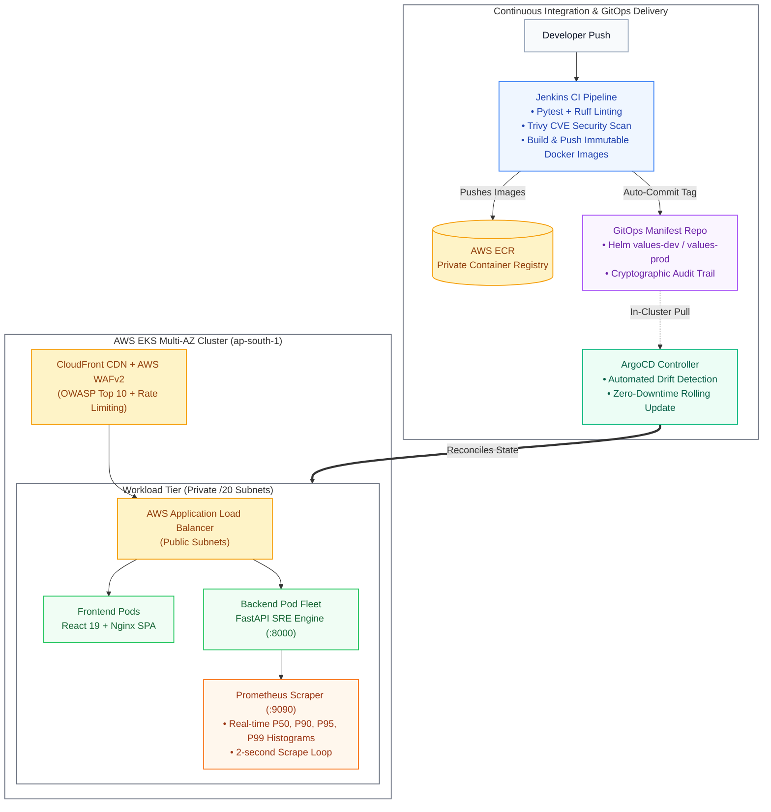

<p align="center">
  
</p>

# SimianX

**Cloud-Native SRE Resilience & Observability Platform**

[](https://kubernetes.io/)
[](https://aws.amazon.com/eks/)
[](https://www.terraform.io/)
[](https://helm.sh/)
[](https://www.jenkins.io/)
[](https://argo-cd.readthedocs.io/)
[](https://prometheus.io/)

SimianX is a cloud-native platform designed to simulate concurrent traffic spikes, evaluate SRE Golden Signals, and track real-time latency percentiles (P50, P90, P95, P99) across container fleets. 

Built on AWS EKS with Infrastructure as Code (Terraform), declarative Helm packaging, an automated Jenkins CI pipeline with Trivy container security scans, and continuous GitOps reconciliation using Argo CD.

---

## Architecture



---

## Core Capabilities

* **High-Density Networking:** Multi-AZ AWS EKS v1.31 provisioned on `/20` private subnets (4,096 IPs per subnet) to eliminate AWS VPC CNI IP-exhaustion during pod autoscaling.
* **Edge Security & CDN:** Multi-Origin CloudFront with S3 Origin Access Control (OAC) for static assets and AWS WAF (6 managed and custom rules for OWASP Top 10 and rate-limiting) protecting upstream Kubernetes ingress.
* **Declarative GitOps:** Jenkins CI packages containers and updates environment-scoped Helm values; in-cluster Argo CD pulls and reconciles state automatically.
* **SRE Telemetry & Percentiles:** Asynchronous FastAPI workload generator calculating real-time P50, P90, P95, and P99 latency quantiles streamed to Prometheus and visualized on Grafana.

---

## Tech Stack

| Layer | Tooling | Description |
|---|---|---|
| **Cloud Infrastructure** | AWS EKS, VPC, ECR | Multi-AZ Kubernetes compute with IAM Roles for Service Accounts (IRSA) |
| **Edge Security** | CloudFront + AWS WAFv2 | Global CDN with rate-limiting and OWASP protection |
| **Infrastructure as Code** | Terraform | Environment-isolated workspaces with S3 remote state locking |
| **Package Management** | Helm v3 | Parameterized charts with environment overrides (`dev`, `prod`) |
| **Continuous Integration** | Jenkins | Automated testing, Trivy CVE scanning, and image publishing |
| **Continuous Delivery** | Argo CD | In-cluster GitOps engine with automated drift detection |
| **Observability** | Prometheus + Grafana | Service metrics, Golden Signals, and latency histograms |
| **Application Services** | FastAPI + React 19 | Python 3.12 async backend & TypeScript dark-mode dashboard |

---

## Quick Start (Local Development)

### Run with Docker Compose
The fastest way to spin up the full stack locally:

```bash
docker compose up --build
```

* **Frontend Dashboard:** [http://localhost:3000](http://localhost:3000)
* **Backend API & Swagger Docs:** [http://localhost:8000/docs](http://localhost:8000/docs)
* **Prometheus Metrics:** [http://localhost:8000/metrics](http://localhost:8000/metrics)

---

### Run on Local Kubernetes (Kind)

Deploy the entire platform into a local Kind Kubernetes cluster:

```bash
# 1. Create Kind cluster and deploy via Helm
make kind-up

# 2. Port-forward backend service
kubectl port-forward svc/simianx-backend 8000:8000 -n simianx

# 3. Teardown when finished
make kind-down
```

---

## Infrastructure Provisioning (AWS)

Prerequisites:
* [AWS CLI](https://aws.amazon.com/cli/) configured with deployment permissions
* [Terraform](https://www.terraform.io/) >= 1.8.0
* [Helm](https://helm.sh/) >= 3.14.0

### Provision DEV Environment
```bash
cd terraform/environments/dev
terraform init
terraform plan
terraform apply
```

### Provision PROD Environment
```bash
cd terraform/environments/prod
terraform init
terraform plan
terraform apply
```

### Deploy Frontend to S3 + CloudFront CDN
```bash
make frontend-deploy-dev
```

---

## Quality Gates & Automation

Run quality checks locally before committing:

```bash
# Run backend tests (pytest), linter (ruff), and frontend build
make test

# Lint Helm charts across local, dev, and prod profiles
make helm-lint

# Validate Terraform formatting and syntax
make tf-validate
```

---

## Repository Structure

```text
├── .github/workflows/       # PR gatekeeper CI workflows (Ruff, Pytest, Helm lint)
├── argocd/                  # GitOps application manifests (dev & prod)
├── backend/                 # FastAPI application, telemetry engine, and unit tests
├── docker-compose.yml       # Local multi-container development environment
├── frontend/                # React 19 + TypeScript dashboard
├── helm/                    # Helm chart with environment-specific values
├── jenkins/                 # Jenkins declarative pipeline & worker Dockerfile
├── kind-config.yaml         # Local multi-node Kind cluster configuration
├── Makefile                 # Common developer and deployment commands
└── terraform/               # Multi-environment AWS infrastructure modules
```

---

## License

This project is licensed under the MIT License.
