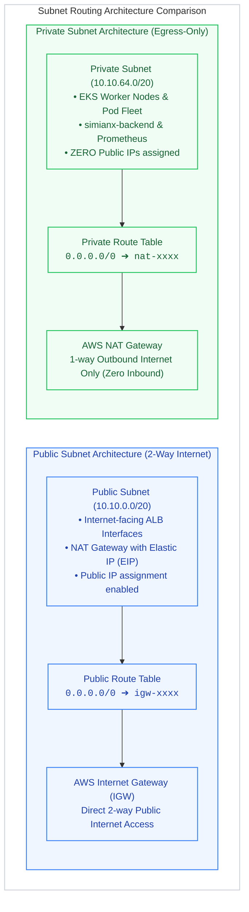
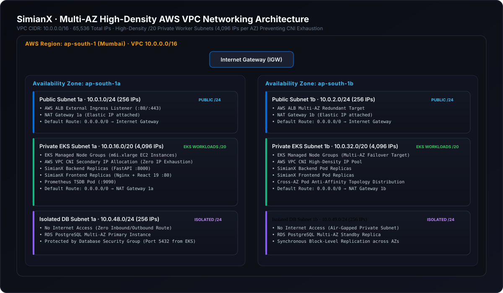

# 🌐 SimianX AWS VPC & Cloud Networking Architecture Guide
> *"If you don't know the difference between a Route Table and a NAT Gateway, or why Kubernetes pods can rapidly exhaust an entire `/24` subnet — relax. This is the definitive, no-fluff masterclass on designing enterprise-grade AWS VPC networking for Kubernetes (EKS) from absolute zero to senior cloud architect."*

---

## 📑 Table of Contents
1. [The 30-Second Elevator Pitch](#1-the-30-second-elevator-pitch)
2. [Chapter 1: AWS Networking Fundamentals Explained from Scratch](#2-chapter-1-aws-networking-fundamentals-explained-from-scratch)
   - [What is a VPC (Virtual Private Cloud)?](#what-is-a-vpc-virtual-private-cloud)
   - [CIDR Notation & Subnet Math Demystified](#cidr-notation--subnet-math-demystified)
   - [The 5 AWS Reserved IPs in Every Subnet](#the-5-aws-reserved-ips-in-every-subnet)
   - [Public vs. Private Subnets: The Route Table Reality](#public-vs-private-subnets-the-route-table-reality)
3. [Chapter 2: The SimianX VPC Network Topology & Traffic Flow](#3-chapter-2-the-simianx-vpc-network-topology--traffic-flow)
4. [Chapter 3: Environment CIDR Matrix & IP Allocations](#4-chapter-3-environment-cidr-matrix--ip-allocations)
   - [Dev Environment (10.10.0.0/16)](#dev-environment-10100016)
   - [Prod Environment (10.20.0.0/16)](#prod-environment-10200016)
   - [Why EKS Demands Massive Subnets (/20)](#why-eks-demands-massive-subnets-20)
5. [Chapter 4: The Kubernetes EKS Subnet Tagging Contract](#5-chapter-4-the-kubernetes-eks-subnet-tagging-contract)
   - [`kubernetes.io/role/elb = 1`](#kubernetesioroleelb--1)
   - [`kubernetes.io/role/internal-elb = 1`](#kubernetesioroleinternal-elb--1)
   - [`kubernetes.io/cluster/<cluster-name> = shared / owned`](#kubernetesioclustercluster-name--shared--owned)
6. [Chapter 5: Gateway Mechanics & Traffic Egress (IGW vs. NAT GW)](#6-chapter-5-gateway-mechanics--traffic-egress-igw-vs-nat-gw)
   - [Internet Gateway (IGW)](#internet-gateway-igw)
   - [NAT Gateway & Elastic IP (EIP)](#nat-gateway--elastic-ip-eip)
   - [FinOps: Single NAT vs. Multi-AZ NAT](#finops-single-nat-vs-multi-az-nat)
7. [Chapter 6: Terraform Code Walkthrough (`terraform/modules/vpc/`)](#7-chapter-6-terraform-code-walkthrough)
8. [Chapter 7: Top 10 VPC & Cloud Networking Interview Questions](#8-chapter-7-top-10-vpc--cloud-networking-interview-questions)
9. [Chapter 8: Troubleshooting & Verification Runbook](#9-chapter-8-troubleshooting--verification-runbook)

---

## 1. The 30-Second Elevator Pitch
*(Memorize this for interviews when asked: "How did you design the networking for your Kubernetes infrastructure?")*

> **"For SimianX, I engineered a multi-tier, multi-AZ AWS VPC architecture with strict network isolation. We partitioned a `/16` CIDR block across dual Availability Zones in `ap-south-1` using `/20` subnets to provide over 4,000 IPs per tier, preventing AWS VPC CNI pod IP exhaustion.**
> **Public subnets host only the internet-facing Application Load Balancer and NAT Gateway, while all EKS worker nodes and stateful microservices are locked in isolated private subnets with no inbound route from the internet. Outbound traffic routes egress-only through a managed NAT Gateway, and subnets are dynamically tagged to satisfy the AWS Load Balancer Controller subnet discovery contract."**

---

## 2. Chapter 1: AWS Networking Fundamentals Explained from Scratch

### What is a VPC (Virtual Private Cloud)?
Imagine AWS is a gigantic public hotel with millions of rooms. A **VPC** is your private, soundproof, keycard-access-only floor inside that hotel.
* No one outside your floor can see your servers or reach your database unless you deliberately install an **Internet Gateway (IGW)** door.
* In SimianX, our VPC is our isolated virtual data center in the AWS Mumbai region (`ap-south-1`).

---

### CIDR Notation & Subnet Math Demystified
IP addresses are 32-bit binary numbers divided into 4 octets:
$$\text{Example: } 10.10.0.0 = \underbrace{00001010}_{\text{10}} . \underbrace{00001010}_{\text{10}} . \underbrace{00000000}_{\text{0}} . \underbrace{00000000}_{\text{0}}$$

The `/16` or `/20` prefix indicates **how many bits are locked as the network prefix**. The remaining bits belong to host devices:
$$\text{Total Available IPs} = 2^{(32 - \text{Prefix})}$$

* **`/16` VPC:** $32 - 16 = 16$ bits for hosts $\rightarrow 2^{16} = \mathbf{65,536\text{ total IP addresses}}$.
* **`/20` Subnet:** $32 - 20 = 12$ bits for hosts $\rightarrow 2^{12} = \mathbf{4,096\text{ total IP addresses}}$.
* **`/24` Subnet (traditional web app):** $32 - 24 = 8$ bits for hosts $\rightarrow 2^8 = \mathbf{256\text{ total IP addresses}}$.

---

### The 5 AWS Reserved IPs in Every Subnet
Whenever you create any subnet in AWS, **AWS automatically confiscates 5 IP addresses**. You can never assign these to EC2 instances or pods:

For example, in subnet `10.10.0.0/20`:
1. **`10.10.0.0`**: **Network Address** (identifies the subnet network wire).
2. **`10.10.0.1`**: **VPC Router** (default gateway for internal subnet routing).
3. **`10.10.0.2`**: **Amazon Provided DNS / Route 53 Resolver** (base IP + 2).
4. **`10.10.0.3`**: **Reserved by AWS for future use**.
5. **`10.10.15.255`**: **Network Broadcast Address** (AWS doesn't support broadcast, but reserves it).

$$\text{Usable IPs in a /20 subnet} = 4,096 - 5 = \mathbf{4,091\text{ usable host IPs}}$$

---

### Public vs. Private Subnets: The Route Table Reality
Many beginners assume a "private subnet" uses special encrypted cables. **That is false.** 
In AWS, the *only* difference between a public subnet and a private subnet is its **Route Table association**:



* **Public Subnet**: Its route table has a default route (`0.0.0.0/0`) pointing directly to an **Internet Gateway (`igw-xxxx`)**. Inbound and outbound internet traffic are both permitted.
* **Private Subnet**: Its route table has a default route (`0.0.0.0/0`) pointing to a **NAT Gateway (`nat-xxxx`)**. Inbound connections from the public internet are physically impossible; pods can only initiate outbound requests.

---

## 3. Chapter 2: The SimianX VPC Network Topology & Traffic Flow



---

## 4. Chapter 3: Environment CIDR Matrix & IP Allocations

To guarantee zero network overlap between environments, we allocate separate non-conflicting `/16` supernets:

### Dev Environment (`10.10.0.0/16`)
| Subnet Name | Type | CIDR Block | Availability Zone | Usable IPs | Primary Purpose |
| :--- | :--- | :--- | :--- | :---: | :--- |
| `simianx-public-dev-1` | Public | `10.10.0.0/20` | `ap-south-1a` | 4,091 | ALB Public Ingress, NAT Gateway |
| `simianx-public-dev-2` | Public | `10.10.16.0/20` | `ap-south-1b` | 4,091 | ALB Redundant Availability Zone |
| `simianx-private-dev-1` | Private | `10.10.64.0/20` | `ap-south-1a` | 4,091 | EKS Worker Nodes, Backend Pods, Prometheus |
| `simianx-private-dev-2` | Private | `10.10.80.0/20` | `ap-south-1b` | 4,091 | Multi-AZ Pod Failover, Secondary Worker Nodes |

### Prod Environment (`10.20.0.0/16`)
| Subnet Name | Type | CIDR Block | Availability Zone | Usable IPs | Primary Purpose |
| :--- | :--- | :--- | :--- | :---: | :--- |
| `simianx-public-prod-1` | Public | `10.20.0.0/20` | `ap-south-1a` | 4,091 | Production ALB Ingress |
| `simianx-public-prod-2` | Public | `10.20.16.0/20` | `ap-south-1b` | 4,091 | Production ALB Redundancy |
| `simianx-private-prod-1` | Private | `10.20.64.0/20` | `ap-south-1a` | 4,091 | Production Multi-replica EKS Nodes |
| `simianx-private-prod-2` | Private | `10.20.80.0/20` | `ap-south-1b` | 4,091 | Production Multi-replica EKS Nodes |

---

### Why EKS Demands Massive Subnets (`/20`)

In standard VM architectures, 1 EC2 instance = 1 IP address. A small `/24` subnet (251 usable IPs) can easily host 200 servers.

**In Kubernetes with AWS EKS, this assumption will crash your cluster.**

* **The AWS VPC CNI Plugin**: Unlike other Kubernetes CNI plugins that create virtual overlay networks (like Flannel or Calico overlay), AWS EKS assigns **real, routable VPC IP addresses directly to every single Kubernetes pod**.
* A single `t3.medium` EC2 worker node can attach up to 3 Elastic Network Interfaces (ENIs), with up to 6 secondary IPs per ENI. That node alone can consume **18 IP addresses from your subnet**.
* If you run 20 pods per node across 5 nodes, plus rolling updates (which spin up old and new pods simultaneously), **a small `/24` subnet will run out of IPs in minutes**.
* When a subnet runs out of IPs, AWS EKS throws the dreaded error:
  ```text
  FailedCreatePodSandBox: failed to assign an IP address to container
  ```
* **Our Solution:** By using `/20` subnets (4,091 usable IPs per subnet), SimianX has virtually infinite headroom for high-density pod auto-scaling and traffic bursts.

---

## 5. Chapter 4: The Kubernetes EKS Subnet Tagging Contract

When you deploy the **AWS Load Balancer Controller** into Kubernetes, how does it know which subnets to put the public Load Balancer into?

It doesn't guess. It scans the AWS API for **mandatory Kubernetes resource tags**. If your Terraform code forgets these tags, your Kubernetes Ingress will hang forever with:
> `failed to discover subnets for frontend ALB`

Here are the exact tags configured in our Terraform VPC module:

### `kubernetes.io/role/elb = 1`
* **Assigned To:** Public Subnets ([`terraform/modules/vpc/main.tf#L36`](file:///Users/princekumar/Desktop/Scalekart/terraform/modules/vpc/main.tf#L36))
* **Function:** Informs the AWS Load Balancer Controller: *"This is a public, internet-facing subnet. Deploy external ALBs here."*

### `kubernetes.io/role/internal-elb = 1`
* **Assigned To:** Private Subnets ([`terraform/modules/vpc/main.tf#L50`](file:///Users/princekumar/Desktop/Scalekart/terraform/modules/vpc/main.tf#L50))
* **Function:** Informs the controller: *"This is an internal subnet. Deploy private, internal-only VPC load balancers here."*

### `kubernetes.io/cluster/<cluster-name> = shared / owned`
* **Assigned To:** Both Public and Private Subnets
* **Function:** Associates the subnets with our specific cluster (`simianx-eks-dev`). `shared` indicates that multiple clusters or VPC resources can utilize the same network layer.

---

## 6. Chapter 5: Gateway Mechanics & Traffic Egress

### Internet Gateway (IGW)
* **What it is:** A horizontally scaled, redundant, highly available AWS VPC component that acts as the default gateway for public subnets.
* **Does it perform NAT?** Yes, for public IPv4 addresses, it translates the private VPC IP to the public IPv4 address assigned to the resource.

### NAT Gateway & Elastic IP (EIP)
* **What it is:** Network Address Translation (NAT) service placed in a **Public Subnet** with a static Elastic IP.
* **Why Private Nodes Need It:** EKS worker nodes in private subnets have no public IP addresses. However, they need to reach the outside world to:
  1. Pull container images from GitHub Packages or Docker Hub.
  2. Send outbound API calls to AWS STS, KMS, and CloudWatch.
  3. Download Linux packages and security updates.
* **The Route:** The private route table directs all non-VPC traffic (`0.0.0.0/0`) to the NAT Gateway ID (`nat-03ef...`). The NAT Gateway rewrites the source IP to its Elastic IP, forwards the packet to the Internet Gateway, and tracks the response.

---

### FinOps: Single NAT vs. Multi-AZ NAT
In AWS, every NAT Gateway costs **$0.045 / hour (~$32.40 / month)** plus $0.045 per GB of data processed.

* **Dev Environment Strategy (Single NAT):**
  * We provision **1 NAT Gateway** in Public Subnet 1 (`ap-south-1a`), shared by all private subnets.
  * **Cost:** ~$32 / month. Perfect for dev/testing environments where cross-AZ failover of outbound egress is not worth doubling the infrastructure cost.
* **Prod Environment Strategy (Multi-AZ NAT):**
  * We provision **2 NAT Gateways** (one in each AZ: `ap-south-1a` and `ap-south-1b`).
  * **Cost:** ~$65 / month. If AWS has an AZ-level datacenter outage in `ap-south-1a`, worker nodes in `ap-south-1b` can still route outbound traffic without interruption.

---

## 7. Chapter 6: Terraform Code Walkthrough

Let's dissect the exact Terraform syntax used in [`terraform/modules/vpc/main.tf`](file:///Users/princekumar/Desktop/Scalekart/terraform/modules/vpc/main.tf):

### 1. Dynamic Subnet Slicing with `cidrsubnet()`
```hcl
resource "aws_subnet" "public" {
  count                   = 2
  vpc_id                  = aws_vpc.main.id
  cidr_block              = cidrsubnet(var.vpc_cidr, 4, count.index)
  availability_zone       = data.aws_availability_zones.available.names[count.index]
  map_public_ip_on_launch = true
}
```
* `cidrsubnet(prefix, newbits, netnum)`:
  * `prefix`: `10.10.0.0/16`
  * `newbits`: `4` (expands `/16` to `/20`)
  * `netnum`:
    * When `count.index = 0`: produces `10.10.0.0/20` (AZ 1 Public)
    * When `count.index = 1`: produces `10.10.16.0/20` (AZ 2 Public)

### 2. Private Subnet Offset
```hcl
resource "aws_subnet" "private" {
  count             = 2
  vpc_id            = aws_vpc.main.id
  cidr_block        = cidrsubnet(var.vpc_cidr, 4, count.index + 4)
  availability_zone = data.aws_availability_zones.available.names[count.index]
}
```
* `count.index + 4`: Shifts the network number index by 4 so private subnets don't collide with public subnets:
  * When `count.index = 0` ($0 + 4 = 4$): produces `10.10.64.0/20` (AZ 1 Private)
  * When `count.index = 1` ($1 + 4 = 5$): produces `10.10.80.0/20` (AZ 2 Private)

---

## 8. Chapter 7: Top 10 VPC & Cloud Networking Interview Questions

### Q1: Why did you place your EKS worker nodes in private subnets instead of public subnets?
> **Answer:** *"Defense-in-depth security. By keeping worker nodes in private subnets, they are not directly addressable or discoverable from the public internet. There is zero risk of an open NodePort or misconfigured security group exposing our backend pods to port-scanning bots. Inbound traffic must pass through the AWS Application Load Balancer in the public subnet, where SSL termination, WAF filtering, and path-routing take place."*

### Q2: What happens if an EKS cluster runs out of IP addresses in its subnet?
> **Answer:** *"Because the AWS VPC CNI plugin assigns real secondary VPC IPs to every container, running out of IP addresses causes `FailedCreatePodSandBox` errors. Pods stay stuck in `Pending` or `ContainerCreating` states, unable to schedule. We prevented this in SimianX by sizing our private subnets as `/20` (providing 4,091 usable IPs per subnet), offering massive headroom for scaling."*

### Q3: Why does AWS require public subnets across at least 2 Availability Zones for an ALB?
> **Answer:** *"AWS Application Load Balancers are managed, distributed software routers. To ensure high availability and survive a physical datacenter disruption, AWS requires ALBs to be attached to public subnets in at least two distinct Availability Zones before the ALB can be provisioned."*

### Q4: Can an EC2 instance in a private subnet be reached from the public internet if you assign it an Elastic IP?
> **Answer:** *"No! An Elastic IP alone does not make an instance reachable. Routing dictates reachability. If the subnet's Route Table does not have a route target pointing to an Internet Gateway (`0.0.0.0/0 -> igw`), packets from the internet will never find a route into the subnet."*

### Q5: What is the purpose of the `kubernetes.io/role/elb = 1` tag?
> **Answer:** *"It is the discovery contract for the AWS Load Balancer Controller. When an Ingress resource with `alb.ingress.kubernetes.io/scheme: internet-facing` is created in Kubernetes, the controller queries the AWS EC2 API for subnets with this exact tag to determine where to place the ALB public interfaces."*

### Q6: What is the difference between a Security Group and a Network ACL (NACL)?
> **Answer:** 
> * **Security Group:** Operates at the **instance/ENI level**. It is **stateful** (if inbound traffic is allowed, return outbound traffic is automatically permitted). Supports allow rules only.
> * **NACL:** Operates at the **subnet boundary level**. It is **stateless** (inbound and outbound rules must be explicitly defined). Supports both allow and deny rules evaluated in numerical order.

### Q7: Why do we place the NAT Gateway in the Public Subnet instead of the Private Subnet?
> **Answer:** *"A NAT Gateway must itself have access to the Internet Gateway to forward translated outbound packets. If you placed the NAT Gateway in a private subnet, it would have no route to the internet, creating a dead-end routing loop."*

### Q8: What is the difference between `enable_dns_hostnames` and `enable_dns_support` in an AWS VPC?
> **Answer:** 
> * `enable_dns_support`: Enables the AWS-provided DNS resolver at `VPC_CIDR_BASE + 2` (e.g., `10.10.0.2`).
> * `enable_dns_hostnames`: Dictates whether instances launched into the VPC receive public/private DNS hostnames matching their IP. **Both must be set to `true` for AWS EKS control plane registration.**

### Q9: How does CloudFront interact with our VPC?
> **Answer:** *"CloudFront is a global edge service located outside our VPC. For our frontend, it serves static assets directly from a private S3 bucket using Origin Access Control (OAC). For API calls (`/api/*`), CloudFront forwards dynamic requests to the public Application Load Balancer sitting in our public subnets, keeping all internal microservices and worker nodes private."*

### Q10: How would you reduce NAT Gateway data processing costs in a high-traffic Kubernetes cluster?
> **Answer:** *"Three primary optimizations: First, configure VPC Endpoints (Gateway endpoints for S3 and DynamoDB are completely free). Second, use VPC Interface Endpoints (AWS PrivateLink) for high-volume internal traffic like ECR container image pulls and CloudWatch logs, keeping data on the AWS private backbone instead of routing through the paid NAT Gateway."*

---

## 8. Chapter 8: Troubleshooting & Verification Runbook

Use these AWS CLI commands to verify and inspect your VPC setup:

### 1. View SimianX VPC ID and CIDR
```bash
aws ec2 describe-vpcs \
  --filters "Name=tag:Project,Values=SimianX" \
  --query "Vpcs[].{VpcId:VpcId,CidrBlock:CidrBlock,State:State,Tags:Tags[?Key=='Name'].Value|[0]}" \
  --output table
```

### 2. Inspect Subnets and Available IP Counts
```bash
aws ec2 describe-subnets \
  --filters "Name=tag:Project,Values=SimianX" \
  --query "Subnets[].{SubnetId:SubnetId,AZ:AvailabilityZone,CIDR:CidrBlock,AvailableIPs:AvailableIpAddressCount,Name:Tags[?Key=='Name'].Value|[0]}" \
  --output table
```

### 3. Check Route Tables & Default Gateway Routes
```bash
aws ec2 describe-route-tables \
  --filters "Name=tag:Project,Values=SimianX" \
  --query "RouteTables[].{RouteTableId:RouteTableId,Name:Tags[?Key=='Name'].Value|[0],Destinations:Routes[].DestinationCidrBlock,Targets:Routes[].GatewayId}" \
  --output table
```

### 4. Check NAT Gateway Status & Elastic IP
```bash
aws ec2 describe-nat-gateways \
  --filter "Name=tag:Project,Values=SimianX" \
  --query "NatGateways[].{NatGatewayId:NatGatewayId,State:State,SubnetId:SubnetId,PublicIP:NatGatewayAddresses[0].PublicIp}" \
  --output table
```

### 5. Verify EKS Subnet Tagging
```bash
aws ec2 describe-subnets \
  --filters "Name=tag:Project,Values=SimianX" \
  --query "Subnets[].{Subnet:Tags[?Key=='Name'].Value|[0],ELB_Tag:Tags[?Key=='kubernetes.io/role/elb'].Value|[0],Internal_ELB_Tag:Tags[?Key=='kubernetes.io/role/internal-elb'].Value|[0]}" \
  --output table
```
