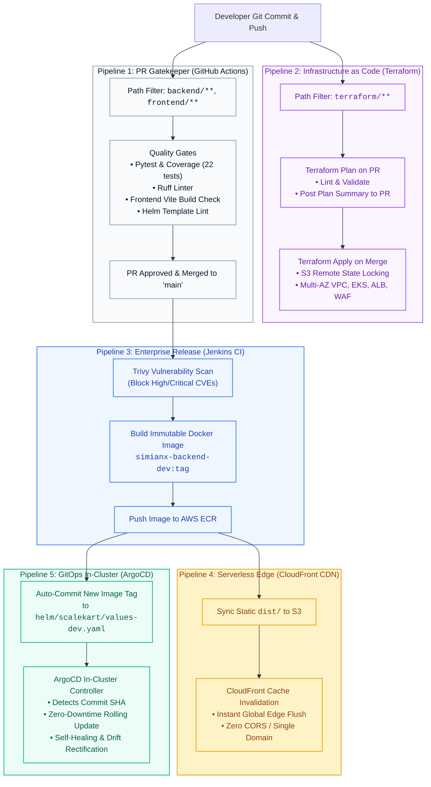
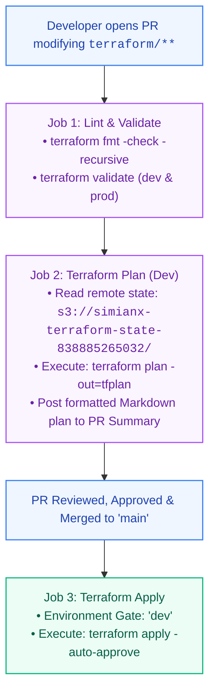
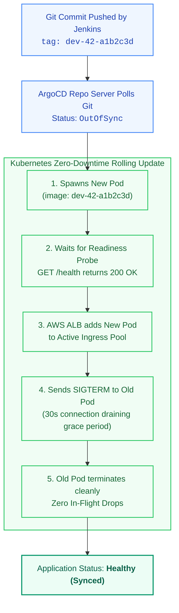

# 🚀 SimianX Production Deployment Pipeline Architecture
> *"Deploying code to production should be as boring and predictable as boiling water. If your deployments involve sweaty palms, manual SSH commands, or praying nothing breaks at midnight — your pipeline is broken. This is the complete, staff-level guide to the SimianX Multi-Pipeline Deployment Architecture."*

---

## 📑 Table of Contents
1. [The 30-Second Elevator Pitch](#1-the-30-second-elevator-pitch)
2. [Chapter 1: The Multi-Pipeline Architecture Overview](#2-chapter-1-the-multi-pipeline-architecture-overview)
   - [Why One Monolithic Pipeline is a Anti-Pattern](#why-one-monolithic-pipeline-is-a-anti-pattern)
   - [The 4 Specialized Pipelines in SimianX](#the-4-specialized-pipelines-in-simianx)
3. [Chapter 2: Pipeline 1 — The PR Gatekeeper (GitHub Actions)](#3-chapter-2-pipeline-1--the-pr-gatekeeper-github-actions)
   - [Shift-Left Testing Philosophy](#shift-left-testing-philosophy)
   - [Quality Gates: Pytest, Ruff & Vite Typecheck](#quality-gates-pytest-ruff--vite-typecheck)
   - [Helm & Terraform Static Template Validation](#helm--terraform-static-template-validation)
4. [Chapter 3: Pipeline 2 — Infrastructure as Code Pipeline (Terraform CI/CD)](#4-chapter-3-pipeline-2--infrastructure-as-code-pipeline-terraform-cicd)
   - [Path-Filtered Triggering (`terraform/**`)](#path-filtered-triggering-terraform)
   - [The Plan Phase: Pull Requests & Drift Detection](#the-plan-phase-pull-requests--drift-detection)
   - [The Apply Phase: Environment Protection & S3 State Locking](#the-apply-phase-environment-protection--s3-state-locking)
5. [Chapter 4: Pipeline 3 — Enterprise Release Orchestrator (Jenkins CI)](#5-chapter-4-pipeline-3--enterprise-release-orchestrator-jenkins-ci)
   - [Trivy Container Security Vulnerability Scanning](#trivy-container-security-vulnerability-scanning)
   - [Immutable Docker Image Tagging & ECR Push](#immutable-docker-image-tagging--ecr-push)
   - [The GitOps Handoff: Automated Values File Commit](#the-gitops-handoff-automated-values-file-commit)
6. [Chapter 5: Pipeline 4 — Serverless Edge Delivery (Frontend CDN)](#6-chapter-5-pipeline-4--serverless-edge-delivery-frontend-cdn)
   - [Static Asset S3 Synchronization](#static-asset-s3-synchronization)
   - [Global CloudFront Cache Invalidation](#global-cloudfront-cache-invalidation)
7. [Chapter 6: Pipeline 5 — In-Cluster GitOps Reconciliation (ArgoCD)](#7-chapter-6-pipeline-5--in-cluster-gitops-reconciliation-argocd)
   - [Continuous Reconciliation Loop](#continuous-reconciliation-loop)
   - [Zero-Downtime Rolling Update Mechanics](#zero-downtime-rolling-update-mechanics)
   - [Self-Healing & Drift Rectification](#self-healing--drift-rectification)
8. [Chapter 7: Deployment Strategies Deep-Dive](#8-chapter-7-deployment-strategies-deep-dive)
   - [Rolling Update (Our Current Standard)](#1-rolling-update-our-current-standard)
   - [Blue/Green Deployments](#2-bluegreen-deployments)
   - [Canary Releases with Argo Rollouts](#3-canary-releases-with-argo-rollouts)
9. [Chapter 8: Secrets Management Across the Pipelines](#9-chapter-8-secrets-management-across-the-pipelines)
10. [Chapter 9: Top 15 Deployment & Pipeline Interview Questions](#10-chapter-9-top-15-deployment--pipeline-interview-questions)
11. [Chapter 10: Production Deployment Runbook](#11-chapter-10-production-deployment-runbook)

---

## 1. The 30-Second Elevator Pitch
*(Memorize this for interviews when asked: "Describe your deployment pipeline from code commit to production.")*

> **"SimianX uses a decoupled, event-driven multi-pipeline architecture that separates infrastructure, application code, and static assets. Pull requests trigger a fast, serverless GitHub Actions gatekeeper that enforces linting, unit tests, and template validation before merging.**
> **Once merged, a Jenkins declarative pipeline executes container security scans via Trivy, builds immutable Docker images tagged with the git commit SHA, pushes to private AWS ECR, and deploys the frontend to S3 with CloudFront CDN cache invalidation. To deploy to Kubernetes, Jenkins commits the new image tag to our Helm values repository. ArgoCD, running natively inside AWS EKS, detects the Git commit and performs an automated, zero-downtime rolling update with self-healing enabled."**

---

## 2. Chapter 1: The Multi-Pipeline Architecture Overview



---

### Why One Monolithic Pipeline is an Anti-Pattern
Many junior engineers build a single giant script that does everything: formats Terraform, builds Docker images, deploys the frontend, and runs `kubectl apply`.

**Why this fails catastrophically in production:**
1. **Cadence Mismatch:** Developers push application code 20 times a day. Infrastructure (VPC, EKS, Subnets) changes once a month. Re-running Terraform on every frontend button fix is dangerous and slow.
2. **Blast Radius & Security:** The pipeline that creates AWS VPCs needs admin IAM permissions. The pipeline that builds a Docker image only needs `ecr:PutImage`. Exposing admin cloud keys to everyday code builds violates the principle of least privilege.
3. **Execution Time:** A unified pipeline takes 15–20 minutes. Modular pipelines execute in 30–90 seconds.

---

## 3. Chapter 2: Pipeline 1 — The PR Gatekeeper (GitHub Actions)

* **Configuration File:** [`.github/workflows/ci.yml`](file:///Users/princekumar/Desktop/Scalekart/.github/workflows/ci.yml)
* **Trigger:** Every Pull Request and commit to `main` (ignoring `terraform/**`).
* **Environment:** Ephemeral GitHub-hosted Ubuntu cloud runners (Zero maintenance, zero server cost).

### Shift-Left Testing Philosophy
"Shift-Left" means catching defects as early in the software development lifecycle as possible. If a bug reaches Jenkins or EKS, it costs 10x more time and stress to debug.

### What It Executes in Parallel:
1. **Backend Quality Gate:**
   ```bash
   cd backend && pip install -r requirements-dev.txt
   ruff check app/ tests/          # Enforces PEP 8 and static security rules
   pytest tests/ -v --cov=app      # Executes all 22 unit & integration tests
   ```
2. **Frontend Quality Gate:**
   ```bash
   cd frontend && npm ci
   npm run build                   # Runs TypeScript typecheck (tsc -b) & Vite bundler
   ```
3. **Helm Quality Gate:**
   ```bash
   helm lint ./helm/scalekart      # Validates YAML syntax & template semantics
   helm template local ./helm/scalekart > /dev/null
   helm template dev ./helm/scalekart -f ./helm/scalekart/values-dev.yaml > /dev/null
   helm template prod ./helm/scalekart -f ./helm/scalekart/values-prod.yaml > /dev/null
   ```

---

## 4. Chapter 3: Pipeline 2 — Infrastructure as Code (Terraform CI/CD)

* **Configuration File:** [`.github/workflows/terraform.yml`](file:///Users/princekumar/Desktop/Scalekart/.github/workflows/terraform.yml)
* **Trigger:** Strictly filtered on changes to `terraform/**` or manual `workflow_dispatch`.



---

## 5. Chapter 4: Pipeline 3 — Enterprise Release Orchestrator (Jenkins CI)

* **Configuration File:** [`Jenkinsfile`](file:///Users/princekumar/Desktop/Scalekart/Jenkinsfile)
* **Trigger:** Triggered upon merge to `main` or executed manually with the `DEPLOY_ENV` choice parameter (`dev` or `prod`).

### Stage Breakdown:
1. **Security Vulnerability Gate (Trivy):**
   ```bash
   trivy fs --severity HIGH,CRITICAL --exit-code 0 .
   ```
   Scans all Python packages, npm dependencies, and Dockerfiles against the National Vulnerability Database (NVD).
2. **AWS ECR Authentication:**
   ```bash
   aws ecr get-login-password --region ${AWS_REGION} | \
       docker login --username AWS --password-stdin ${ECR_REGISTRY}
   ```
   Uses short-lived IAM authorization tokens (valid for 12 hours) instead of static passwords.
3. **Immutable Docker Image Tagging:**
   ```bash
   IMAGE_TAG="${params.DEPLOY_ENV}-${BUILD_NUMBER}-${GIT_COMMIT[0..7]}"
   docker build -t ${ECR_REGISTRY}/simianx-backend-${params.DEPLOY_ENV}:${IMAGE_TAG} ./backend
   docker push ${ECR_REGISTRY}/simianx-backend-${params.DEPLOY_ENV}:${IMAGE_TAG}
   ```
   * **Rule:** Never deploy `:latest` in production! Every image is tagged with its environment, build number, and git commit SHA.

---

## 6. Chapter 5: Pipeline 4 — Serverless Edge Delivery (Frontend CDN)

Because the frontend is decoupled from Kubernetes, its deployment is instant (takes ~15 seconds) and never touches EKS:

```bash
# Executed via Jenkins stage or "make frontend-deploy-dev"
cd frontend && npm ci && npm run build

# 1. Sync static bundle to 100% private S3 bucket (protected by OAC)
aws s3 sync frontend/dist/ s3://simianx-frontend-dev-838885265032 --delete

# 2. Invalidate CloudFront CDN edge cache
aws cloudfront create-invalidation --distribution-id $DIST_ID --paths "/*"
```

* **Multi-Origin Routing:** CloudFront acts as the unified reverse proxy. Static requests (`/*`) route to S3 via SigV4 Origin Access Control (OAC), while dynamic requests (`/api/*`) proxy to the EKS Application Load Balancer with zero CORS overhead and a single domain name (`https://d187dv15yxfrzi.cloudfront.net`).
* **AWS WAFv2 Edge Inspection:** Every request to CloudFront is filtered through 6 enterprise WAF rules (OWASP Top 10, Bad Inputs/Log4j, Amazon IP Reputation, Anonymous IPs, SQLi, and Rate Limiting per IP) before hitting S3 or EKS.
* **`--delete` flag:** Ensures removed or renamed assets from previous builds are deleted from S3, preventing orphaned files.
* **Cache Invalidation:** Flushes cached copies across 450+ CloudFront edge servers worldwide, ensuring users instantly receive the latest release.
* 📖 *Full Architectural Deep Dive:* See [`docs/EDGE_SECURITY_CLOUDFRONT_WAF.md`](file:///Users/princekumar/Desktop/Scalekart/docs/EDGE_SECURITY_CLOUDFRONT_WAF.md).

---

## 7. Chapter 6: Pipeline 5 — In-Cluster GitOps Reconciliation (ArgoCD)

* **Configuration Files:** [`argocd/application-dev.yaml`](file:///Users/princekumar/Desktop/Scalekart/argocd/application-dev.yaml) & [`argocd/application-prod.yaml`](file:///Users/princekumar/Desktop/Scalekart/argocd/application-prod.yaml)



---

## 8. Chapter 7: Deployment Strategies Deep-Dive

In enterprise DevOps, choosing how new code replaces old code is critical:

### 1. Rolling Update (Our Current Standard)
* **How it works:** Progressively replaces old pods with new pods one by one.
* **Controlled by:**
  * `maxSurge: 25%` (Specifies how many additional pods above desired replica count can be created).
  * `maxUnavailable: 0` (Guarantees that 100% of desired pods are active before any old pod is terminated).
* **Pros:** Zero downtime; requires no extra infrastructure.
* **Cons:** During rollout, both old and new versions run simultaneously (requires backward-compatible database schemas).

### 2. Blue/Green Deployments
* **How it works:** Provisions an entirely separate, duplicate environment (Green) running the new version alongside the current version (Blue). Once tested, the load balancer switches traffic from Blue to Green instantly.
* **Pros:** Instant cutover and near-instant rollback (just switch the load balancer back).
* **Cons:** Doubles infrastructure compute costs during deployment.

### 3. Canary Releases with Argo Rollouts
* **How it works:** Routes a tiny percentage of live user traffic (e.g., 5%) to the new version.
* **Automated Rollback:** Argo Rollouts queries **Prometheus** every 30 seconds (`sum(rate(http_requests_total{status=~"5.."}[1m]))`). If the error rate exceeds 1%, Argo Rollouts automatically aborts the canary and rolls traffic back to 100% stable without human intervention.

---

## 9. Chapter 8: Secrets Management Across the Pipelines

| Level | Secret Store | Where It Lives | What It Stores |
| :--- | :--- | :--- | :--- |
| **GitHub Actions** | GitHub Repository Secrets | Encrypted in GitHub Cloud | `AWS_ACCESS_KEY_ID`, `AWS_SECRET_ACCESS_KEY` |
| **Jenkins** | Jenkins Credentials Store | Encrypted on Jenkins Master (AES) | AWS IAM credentials, GitHub Personal Access Token |
| **EKS Kubernetes** | AWS Secrets Manager + ESO | Encrypted in AWS KMS | Database passwords, API tokens, sensitive environment variables |

> [!CAUTION]
> **The Golden Rule of GitOps:**
> Never commit unencrypted secrets to Git. Use the **External Secrets Operator (ESO)** to synchronize secrets from AWS Secrets Manager into native Kubernetes secrets at runtime.

---

## 10. Chapter 9: Top 15 Deployment & Pipeline Interview Questions

### Q1: Walk me through your deployment pipeline from git push to production.
> **Answer:** *(Deliver the [30-Second Elevator Pitch](#1-the-30-second-elevator-pitch) at the top of this document).*

### Q2: What is the difference between Blue/Green and Canary deployments?
> **Answer:** *"Blue/Green deploys a full duplicate environment and switches 100% of traffic at once. Canary routes a tiny fraction of live user traffic (e.g. 5% or 10%) to the new release while monitoring telemetry like Prometheus error rates and P95 latency. If metrics degrade, the canary aborts automatically; if healthy, traffic scales to 100%."*

### Q3: Why did you separate your Terraform CI/CD from your application CI/CD?
> **Answer:** *"Different cadence and blast radius. App code changes multiple times daily and needs minimal IAM permissions to push images. Terraform changes rarely and requires high-privilege cloud admin permissions. Keeping them separate minimizes security exposure and prevents accidental infrastructure changes during application deploys."*

### Q4: How do you achieve zero downtime during a Kubernetes deployment?
> **Answer:** *"By combining `readinessProbe` with `maxUnavailable: 0` in our deployment spec. Kubernetes launches new pods first and does not route traffic to them until their `/health` endpoint responds with 200 OK. Only after new pods are verified healthy does Kubernetes deregister and terminate old pods."*

### Q5: How do you handle database migrations in an automated CI/CD pipeline?
> **Answer:** *"Database migrations must always be backward-compatible (the Expand/Contract pattern). Never drop columns or rename fields in the same release. We run migrations as a Kubernetes `PreSync` Job in ArgoCD before new pods start, ensuring the database supports both old and new code simultaneously."*

### Q6: What happens if an image pull fails during an ArgoCD rolling update?
> **Answer:** *"The new pod enters `ImagePullBackOff` or `ErrImagePull`. Because `readinessProbe` never passes, Kubernetes refuses to terminate the healthy old pods. Live users experience zero downtime. ArgoCD flags the application as `Degraded`, and an alert is fired to Slack/PagerDuty."*

### Q7: Why do you tag Docker images with the Git commit SHA instead of `:latest`?
> **Answer:** *"`:latest` is mutable and ambiguous. You cannot determine which code is running, cannot roll back reliably, and Kubernetes nodes may cache an old `:latest` image and fail to pull updates. Tagging with the Git SHA guarantees immutability, traceability, and deterministic rollbacks."*

### Q8: What is an ephemeral environment and how would you build one?
> **Answer:** *"An ephemeral environment is a temporary, isolated preview environment spun up for a specific Pull Request and deleted when the PR merges. Using ArgoCD ApplicationSets and PR-based Helm overrides, we can automatically spin up a `simianx-pr-123` namespace with its own ingress URL so QA can test features before merging."*

### Q9: How do you ensure high availability in Jenkins?
> **Answer:** *"Decouple compute from state. Run the Jenkins Controller with persistent volume storage for configuration and jobs, and use ephemeral **Jenkins Kubernetes Agents** that spin up as pods on EKS only when a build starts and terminate immediately after."*

### Q10: What is the difference between `npm run build` and `npm run dev` in production?
> **Answer:** *"`npm run dev` runs a local development server with unminified code, source maps, and Hot Module Replacement (HMR). `npm run build` uses Vite and Rollup to tree-shake unused code, compile TypeScript, minify JavaScript and CSS, and generate optimized static assets for S3 and CloudFront."*

### Q11: How do you handle rolling back a bad release in GitOps?
> **Answer:** *"Run `git revert <commit-sha>` and push to `main`. Because Git is the single source of truth, ArgoCD detects the revert and automatically reconciles the cluster back to the previous stable image tag within seconds, preserving our audit history."*

### Q12: What is Trivy and what happens when it finds a vulnerability?
> **Answer:** *"Trivy is a vulnerability scanner that inspects OS packages and software libraries for known CVEs. In our Jenkinsfile, it runs before container images are built. If it finds `HIGH` or `CRITICAL` severity CVEs, the pipeline halts immediately, preventing insecure software from reaching AWS ECR."*

### Q13: How does CloudFront cache invalidation work, and why is it needed?
> **Answer:** *"CloudFront caches static files like `index.html` at edge servers globally for 24 hours. When we deploy a new React build, users would continue receiving the old cached `index.html` unless we flush the cache. Running `aws cloudfront create-invalidation --paths '/*'` purges the edge cache in ~15 seconds."*

### Q14: What is the purpose of `prune: true` in an ArgoCD Application?
> **Answer:** *"Without `prune: true`, ArgoCD only adds or updates resources; it never deletes anything. If you remove an obsolete service or configmap from Git, it would remain running as a zombie resource in Kubernetes forever. `prune: true` ensures that when a resource is deleted in Git, it is immediately deleted from the cluster."*

### Q15: How does ArgoCD handle Kubernetes namespace creation?
> **Answer:** *"Through the sync option `CreateNamespace=true`. If the target namespace (e.g. `simianx-dev`) does not exist when ArgoCD initiates deployment, ArgoCD automatically creates the namespace before applying the Helm manifests."*

---

## 11. Chapter 10: Production Deployment Runbook

### 1. Trigger Full Dev Deployment via Makefile
```bash
# 1. Validate all manifests and configs
make test
make helm-lint
make tf-validate

# 2. Deploy Infrastructure (if not running)
make tf-apply-dev

# 3. Deploy Frontend directly to S3 + CloudFront CDN
make frontend-deploy-dev
```

### 2. Verify Deployment Status on EKS
```bash
# Configure kubectl context for EKS
aws eks update-kubeconfig --region ap-south-1 --name simianx-eks-dev

# Check running pods and resource allocations
kubectl get pods -n simianx-dev -o wide

# Check ALB Ingress status and public URL
kubectl get ingress -n simianx-dev
```

### 3. Check Live Application Health
```bash
# Verify backend health endpoint through ALB
ALB_URL=$(kubectl get ingress -n simianx-dev -o jsonpath='{.items[0].status.loadBalancer.ingress[0].hostname}')
curl -I http://${ALB_URL}/health
```
