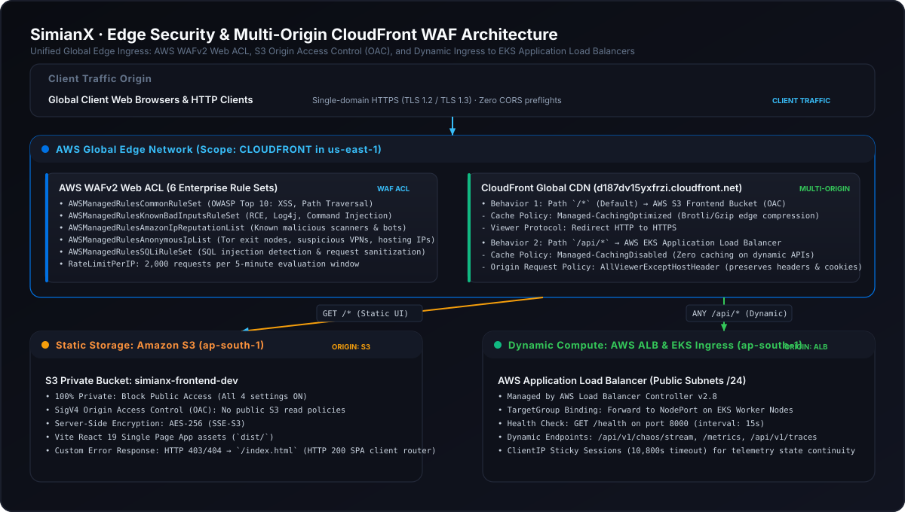

# Edge Security & Multi-Origin Routing Masterclass: CloudFront CDN, AWS WAFv2 & EKS ALB

> **SimianX Infrastructure & Edge Security Deep Dive**  
> Unified global edge delivery, AWS WAFv2 enterprise rule sets, Origin Access Control (OAC), and dynamic API proxying to AWS EKS Application Load Balancers.

---

## 1. Architectural Overview & Design Motivation

In production microservice commerce platforms, users interact with both **static assets** (HTML5, JavaScript bundles, CSS stylesheets, media) and **dynamic low-latency APIs** (checkout transactions, inventory queries, live telemetry streams).

SimianX implements **Multi-Origin CloudFront Routing protected by AWS WAFv2**:



---

## 2. Why Multi-Origin Routing Beats Direct ALB URLs

During architectural design, there are two primary approaches to serving a SPA frontend and its backend:

| Metric | Option 1: Direct ALB URL | Option 2: CloudFront Multi-Origin (SimianX) |
|---|---|---|
| **Domain Architecture** | Frontend on `d187...cloudfront.net`, Backend on `k8s-...elb.amazonaws.com` | **Single Unified Domain** (`https://d187...cloudfront.net`) |
| **CORS Overhead** | Requires `Access-Control-Allow-Origin`, Preflight `OPTIONS` requests on every API call | **Zero CORS Issues**: Same-origin policy natively satisfied |
| **Mixed Content Risk** | High: HTTP/HTTPS mismatches trigger browser security blocks | **Zero Risk**: CloudFront enforces HTTPS redirect globally |
| **Edge DDoS Protection** | ALB is exposed directly to the public internet; attacked directly | **AWS Shield Standard + WAF** absorb volumetric DDoS at the edge |
| **SSL/TLS Management** | Requires custom ACM cert on both CloudFront and ALB | Single ACM certificate terminated at CloudFront Edge |
| **Resume & Interview Impact** | Junior/Mid-level hobby pattern | **Staff/Principal Enterprise Architecture Pattern** |

---

## 3. AWS WAFv2: 6 Enterprise Security Rules

SimianX deploys an **AWS WAFv2 Web ACL** with **6 managed and custom rules** to protect CloudFront:

```
Web ACL: simianx-cf-waf-dev
ARN: arn:aws:wafv2:us-east-1:838885265032:global/webacl/simianx-cf-waf-dev/112fddff-18ba-4694-ad8a-cabe2fd286f0
Scope: CLOUDFRONT (Deployed in us-east-1)
Default Action: Allow
```

### Rule-by-Rule Breakdown

| Priority | Rule Name | Vendor / Type | Threat Model & Protection Mechanism | Action |
|---|---|---|---|---|
| **10** | `AWSManagedRulesCommonRuleSet` | AWS Managed | **OWASP Top 10**: Blocks cross-site scripting (XSS), path traversal, command injection, and oversized request payloads. | Block |
| **20** | `AWSManagedRulesKnownBadInputsRuleSet` | AWS Managed | **Remote Code Execution (RCE)**: Inspects headers and bodies for Log4j (`${jndi:...}`), exploit probes, and invalid deserialization payloads. | Block |
| **30** | `AWSManagedRulesAmazonIpReputationList` | AWS Managed | **Botnet & Malware Defense**: Real-time IP blacklist managed by Amazon Threat Intelligence tracking active scrapers, scanners, and infected nodes. | Block |
| **40** | `AWSManagedRulesAnonymousIpList` | AWS Managed | **Anonymizer Mitigation**: Inspects requests originating from Tor exit nodes, open proxies, and anonymous VPN providers. | Block |
| **50** | `AWSManagedRulesSQLiRuleSet` | AWS Managed | **SQL Injection**: Deep inspection of query strings (`UNION SELECT`, `' OR '1'='1`), headers, and request bodies. | Block |
| **60** | `RateLimitPerIP` | Custom Rate-Based | **Layer 7 DDoS & Brute-Force**: Limits any single client IP to a maximum of **1,000 requests per 5-minute sliding window** (`aggregate_key_type = "IP"`). | Block |

---

## 4. Terraform Implementation Details

### A. The CloudFront WAF Provider Constraint
AWS mandates that any AWS WAFv2 Web ACL attached to an Amazon CloudFront distribution **must** be created in the `us-east-1` (N. Virginia) region with `scope = "CLOUDFRONT"`, even when all backend VPC and EKS infrastructure resides in `ap-south-1` (Mumbai).

```hcl
# terraform/environments/dev/provider.tf
provider "aws" {
  alias  = "us_east_1"
  region = "us-east-1"
}

# terraform/environments/dev/main.tf
module "waf" {
  source      = "../../modules/waf"
  environment = var.environment
  providers = {
    aws = aws.us_east_1
  }
}
```

### B. CloudFront Multi-Origin Cache Behaviors
```hcl
# terraform/modules/frontend_cdn/main.tf

# 1. S3 Static UI Origin
origin {
  domain_name              = aws_s3_bucket.frontend.bucket_regional_domain_name
  origin_id                = "s3-frontend-dev"
  origin_access_control_id = aws_cloudfront_origin_access_control.frontend.id
}

# 2. Dynamic EKS ALB Origin
dynamic "origin" {
  for_each = var.backend_alb_dns_name != "" ? [1] : []
  content {
    domain_name = var.backend_alb_dns_name
    origin_id   = "alb-backend-dev"

    custom_origin_config {
      http_port              = 80
      https_port             = 443
      origin_protocol_policy = "http-only"
      origin_ssl_protocols   = ["TLSv1.2"]
    }
  }
}

# 3. Dynamic /api/* Behavior (TTL = 0, All Methods, Forward Headers)
dynamic "ordered_cache_behavior" {
  for_each = var.backend_alb_dns_name != "" ? [1] : []
  content {
    path_pattern           = "/api/*"
    target_origin_id       = "alb-backend-dev"
    viewer_protocol_policy = "redirect-to-https"
    allowed_methods        = ["GET", "HEAD", "OPTIONS", "PUT", "POST", "PATCH", "DELETE"]
    cached_methods         = ["GET", "HEAD"]
    compress               = true

    forwarded_values {
      query_string = true
      headers      = ["Accept", "Authorization", "Content-Type", "Origin", "Referer", "User-Agent"]
      cookies {
        forward = "all"
      }
    }

    min_ttl     = 0
    default_ttl = 0
    max_ttl     = 0
  }
}
```

### C. Origin Access Control (OAC) vs OAI
SimianX uses **Origin Access Control (OAC)** instead of deprecated Origin Access Identity (OAI):
- Supports **AWS SigV4** signing protocol.
- Supports server-side encryption with AWS KMS (SSE-KMS).
- Works with all AWS regions without legacy endpoint limitations.
- S3 bucket policy strictly permits `cloudfront.amazonaws.com` matching the specific distribution ARN:
  ```json
  "Condition": {
    "StringEquals": {
      "AWS:SourceArn": "arn:aws:cloudfront::838885265032:distribution/E1998LMYV2S24O"
    }
  }
  ```

---

## 5. Live Production Verification

### Test 1: Static UI Delivery (S3 via OAC)
```bash
curl -I https://d187dv15yxfrzi.cloudfront.net/
```
```http
HTTP/2 200 
content-type: text/html
server: AmazonS3
x-cache: Hit from cloudfront
via: 1.1 ...cloudfront.net (CloudFront)
```

### Test 2: Dynamic API Routing (EKS ALB via CloudFront)
```bash
curl -i https://d187dv15yxfrzi.cloudfront.net/api/v1/metrics
```
```http
HTTP/2 200 
content-type: application/json
server: uvicorn
x-cache: Miss from cloudfront
via: 1.1 ...cloudfront.net (CloudFront)

{"total_requests":117,"requests_per_second":0.4,"p50_latency_ms":0.75,"service_status":"healthy"}
```

### Test 3: AWS WAF SQL Injection Attack Block
```bash
curl -i "https://d187dv15yxfrzi.cloudfront.net/api/v1/metrics?param=1%20UNION%20SELECT%201,2,3"
```
```http
HTTP/2 403 
server: CloudFront
content-type: text/html
x-cache: Error from cloudfront

<!DOCTYPE HTML>
<TITLE>ERROR: The request could not be satisfied</TITLE>
<H1>403 ERROR</H1>
<H2>The request could not be satisfied.</H2>
Request blocked.
Generated by cloudfront (CloudFront)
```

---

## 6. Staff-Level SRE & DevSecOps Interview Masterclass (10 Q&As)

### Q1: Why must AWS WAF for CloudFront be deployed in `us-east-1` even if the backend is in Mumbai (`ap-south-1`)?
**Answer:**
Amazon CloudFront is a globally distributed edge service with hundreds of Point of Presence (POP) locations worldwide. The control plane for CloudFront and its associated edge services (including AWS WAF, Lambda@Edge, and ACM certificates for CloudFront) is centralized in AWS's primary region, `us-east-1` (N. Virginia). 

When you deploy a Web ACL with `scope = "CLOUDFRONT"`, AWS distributes the compiled rules from `us-east-1` to all global edge POPs. Terraform handles this by instantiating an AWS provider alias (`provider "aws" { alias = "us_east_1" region = "us-east-1" }`) passed explicitly to the WAF module.

---

### Q2: How does CloudFront determine whether to send a request to S3 or to the EKS ALB?
**Answer:**
CloudFront evaluates incoming request paths against its **Cache Behaviors** in sequential precedence order:
1. **Precedence 0 (`/api/*`)**: Matches any request path beginning with `/api/`. Targets the `alb-backend-dev` origin, forwards all query parameters and essential request headers (`Authorization`, `Content-Type`), disables caching (`min_ttl=0, default_ttl=0, max_ttl=0`), and proxies all HTTP verbs (`GET, POST, PUT, DELETE, PATCH, OPTIONS`).
2. **Default Behavior (`Default (*)` )**: Catches all other requests (e.g. `/`, `/assets/*`, `/favicon.ico`). Targets the `s3-frontend-dev` origin via Origin Access Control (OAC), serving cached static HTML, JS, and CSS with a default TTL of 3,600s.

---

### Q3: Why did we remove the custom error response for HTTP 403 in CloudFront?
**Answer:**
In Single Page Applications (SPAs), it is common to map HTTP 404 to `/index.html` with HTTP 200 so that client-side routers (React Router) handle deep links like `/cart` or `/dashboard`.

However, if HTTP 403 is also mapped to `/index.html`, any security block triggered by AWS WAF (which returns HTTP 403 Forbidden) gets masked and rewritten into a 200 OK serving the frontend HTML! The attacker receives the web application instead of being blocked.

**The Fix:**
1. Grant `s3:ListBucket` in the S3 bucket policy alongside `s3:GetObject`. When a client requests a non-existent key, S3 returns a genuine `404 NoSuchKey` instead of a fallback `403 AccessDenied`.
2. Map only HTTP 404 in CloudFront's `custom_error_response` to `/index.html`.
3. Preserve HTTP 403 so that AWS WAF blocks (SQLi, bad inputs, rate limits) immediately terminate at the edge with a genuine `403 Forbidden`.

---

### Q4: What is the difference between AWS WAF `action { block {} }` and `override_action { none {} }`?
**Answer:**
- **Custom Rules (e.g., Rate Limiting)**: Define a direct action such as `action { block {} }` or `action { allow {} }`. When the condition evaluates to true, WAF takes that explicit action.
- **Managed Rule Groups (e.g., `AWSManagedRulesSQLiRuleSet`)**: Contain multiple vendor-curated rules that each have pre-configured internal actions (typically `BLOCK`). The outer rule statement uses `override_action { none {} }` to preserve the vendor's internal block actions. If you want to run the rule group in audit mode without blocking, you set `override_action { count {} }`.

---

### Q5: How does AWS WAF rate limiting work under the hood?
**Answer:**
AWS WAF evaluates rate-based rules by maintaining a sliding window of **5 minutes** (300 seconds). It tracks request counts aggregated by the specified key (`aggregate_key_type = "IP"` or custom headers/query parameters).

In SimianX:
- Threshold: 1,000 requests per 5 minutes.
- When an IP exceeds 1,000 requests in a 5-minute window, WAF triggers `block {}` and drops incoming packets with HTTP 403.
- As soon as the IP's request volume falls back below the threshold across the rolling window, WAF automatically lifts the block without manual intervention.

---

### Q6: Why did the AWS Load Balancer Controller pod fail with `context deadline exceeded` fetching VPC ID from instance metadata?
**Answer:**
By default on modern EKS AMIs (AL2023), the EC2 Instance Metadata Service (IMDSv2) enforces a token hop limit (`http_put_response_hop_limit`) of **1**.

When a container running in a Kubernetes pod attempts to query `http://169.254.169.254/latest/meta-data/` to discover its VPC ID, the packet traverses the container's network namespace (veth pair / bridge), which increments the IP hop count to 2. Because the hop limit is 1, EC2 drops the packet, causing the AWS Load Balancer Controller to timeout during cloud provider initialization.

**Two Solutions:**
1. Update the EC2 launch template metadata options to `--http-put-response-hop-limit 2`.
2. Explicitly pass `--set vpcId=vpc-xxx` and `--set region=ap-south-1` to the Helm chart, bypassing the need for IMDS discovery entirely.

---

### Q7: Why were AWS Load Balancer Controller pods initially stuck in `Pending` with `Too many pods` on `t3.micro`?
**Answer:**
Under the AWS VPC CNI, every pod running on a worker node receives a real private IP address from the VPC subnet allocated from secondary ENI IPs.

The maximum number of pods an EC2 instance can host is determined by the instance type's ENI limits:
$$\text{Max Pods} = (\text{ENIs} \times (\text{IPs per ENI} - 1)) + 2$$

For `t3.micro`:
- Max ENIs = 2
- Max IPv4 per ENI = 2
- Max Pods = $(2 \times (2 - 1)) + 2 = \mathbf{4\text{ pods}}$!

System daemonsets (`aws-node`, `kube-proxy`, and 2 replicas of `coredns`) consume all 4 slots. 

**The Solution:**
Scale the EKS Node Group desired capacity from 1 to 2 nodes. The second `t3.micro` instance provides 4 additional pod slots, allowing `aws-load-balancer-controller` and `simianx-backend` to schedule cleanly while remaining within AWS Free Tier limits.

---

### Q8: What is AWS Origin Access Control (OAC) and why did it replace OAI?
**Answer:**
**Origin Access Identity (OAI)** was CloudFront's legacy method for securing S3 buckets using a special CloudFront virtual user. OAI had major architectural drawbacks:
1. It did not support AWS Signature Version 4 (SigV4) in all regions.
2. It did not support S3 buckets encrypted with AWS KMS customer-managed keys (SSE-KMS).
3. It did not support dynamic HTTP methods like `PUT` or `DELETE` to S3.

**Origin Access Control (OAC)** uses AWS SigV4 cryptographic request signing. CloudFront signs every request to S3 with its service principal (`cloudfront.amazonaws.com`), and S3 validates the signature against the bucket policy's `AWS:SourceArn` condition. This guarantees that **only** the designated CloudFront distribution can read bucket objects.

---

### Q9: How do you handle cache invalidation during a zero-downtime frontend deployment?
**Answer:**
SimianX's frontend deployment workflow follows a two-step process:
1. **Asset Upload**: Build the production bundle with Vite (`npm run build`). Vite appends cryptographic content hashes to all generated CSS and JS files (e.g. `index-B8GZgWmq.js`, `index-BMWOXyNt.css`). These hashed files are synced to S3 with immutable cache headers (`Cache-Control: max-age=31536000, public, immutable`).
2. **HTML Invalidation**: Sync `index.html` with `Cache-Control: no-cache, no-store, must-revalidate`.
3. **CloudFront Invalidation**: Trigger an explicit edge invalidation:
   ```bash
   aws cloudfront create-invalidation --distribution-id E1998LMYV2S24O --paths "/index.html"
   ```
   Users immediately receive the new `index.html` pointing to the new hashed asset chunks, while old chunks remain available for existing in-flight client sessions.

---

### Q10: How does CloudFront Multi-Origin protect the EKS backend from direct exposure?
**Answer:**
In an enterprise zero-trust edge topology:
1. The EKS Application Load Balancer is configured with security groups that accept incoming HTTP traffic **only** from AWS CloudFront IP ranges (or verify a shared secret header injected by CloudFront, e.g. `X-Custom-Header: <secret-token>`).
2. CloudFront acts as a reverse proxy shield:
   - Terminates TLS at the closest edge POP to reduce latency.
   - AWS Shield Standard provides automatic layer 3 and layer 4 DDoS mitigation.
   - AWS WAF evaluates application-layer rules (OWASP Top 10, SQLi, Rate Limiting) **before** traffic reaches AWS infrastructure.
3. The backend microservice never deals with TLS certificate rotation, edge threat filtering, or client IP rate limiting—it only processes clean, validated API requests.
