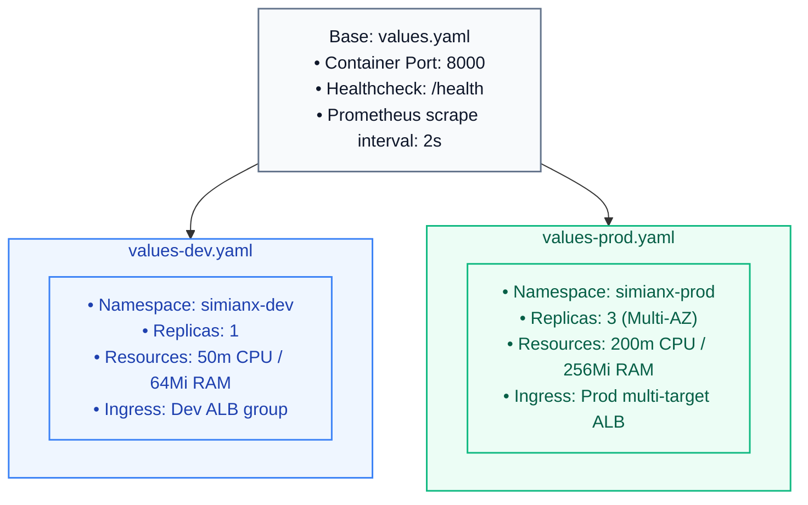

# ⚡ SimianX GitOps CI/CD Masterclass: Jenkins, Helm & ArgoCD
> *"If you think CI/CD just means running `git push` and praying, or you don't know why running `kubectl apply` from Jenkins is a massive security hazard — welcome. This is the definitive, staff-level guide explaining how Jenkins, Helm, and ArgoCD connect to form a modern enterprise GitOps continuous delivery pipeline."*

---

## 📑 Table of Contents
1. [The 30-Second Elevator Pitch](#1-the-30-second-elevator-pitch)
2. [Chapter 1: The Core Trilogy Explained from Scratch (Noob-to-Pro)](#2-chapter-1-the-core-trilogy-explained-from-scratch)
   - [What is Helm? (The Package Manager for Kubernetes)](#what-is-helm)
   - [What is Jenkins? (The Enterprise Automation Engine)](#what-is-jenkins)
   - [What is ArgoCD? (The Declarative GitOps Controller)](#what-is-argocd)
3. [Chapter 2: Push vs. Pull CI/CD (Why GitOps Won the Industry)](#3-chapter-2-push-vs-pull-cicd-why-gitops-won-the-industry)
   - [The Traditional Push Model (And Why It Sucks)](#the-traditional-push-model)
   - [The GitOps Pull Model (The Enterprise Standard)](#the-gitops-pull-model)
4. [Chapter 3: The Complete SimianX End-to-End Delivery Flow](#4-chapter-3-the-complete-simianx-end-to-end-delivery-flow)
5. [Chapter 4: Deep-Dive into Helm Architecture (`helm/scalekart/`)](#5-chapter-4-deep-dive-into-helm-architecture)
   - [Directory Layout & Chart Anatomy](#directory-layout--chart-anatomy)
   - [The Value Profile Strategy (Local vs. Dev vs. Prod)](#the-value-profile-strategy)
   - [DRY Templates & `_helpers.tpl`](#dry-templates--_helperstpl)
6. [Chapter 5: Deep-Dive into Jenkins CI Pipeline (`Jenkinsfile`)](#6-chapter-5-deep-dive-into-jenkins-ci-pipeline)
   - [Declarative Groovy Structure](#declarative-groovy-structure)
   - [Stage-by-Stage Breakdown](#stage-by-stage-breakdown)
   - [The Automated GitOps Commit Mechanism](#the-automated-gitops-commit-mechanism)
7. [Chapter 6: Deep-Dive into ArgoCD GitOps Controller (`argocd/`)](#7-chapter-6-deep-dive-into-argocd-gitops-controller)
   - [The `Application` Custom Resource (CRD)](#the-application-custom-resource-crd)
   - [Self-Healing & Drift Detection (`selfHeal` & `prune`)](#self-healing--drift-detection)
   - [Zero-Downtime Rolling Update Mechanics](#zero-downtime-rolling-update-mechanics)
8. [Chapter 7: Top 15 GitOps, Helm, Jenkins & ArgoCD Interview Questions](#8-chapter-7-top-15-gitops-helm-jenkins--argocd-interview-questions)
9. [Chapter 8: Hands-On Troubleshooting & Verification Runbook](#9-chapter-8-hands-on-troubleshooting--verification-runbook)

---

## 1. The 30-Second Elevator Pitch
*(Memorize this for interviews when asked: "How did you set up CI/CD and deployment for this project?")*

> **"For SimianX, I implemented a true decoupled GitOps continuous delivery pipeline. Jenkins handles Continuous Integration: running parallel Python tests, Ruff linting, Trivy container vulnerability scanning, building multi-arch Docker images, pushing to AWS ECR, and syncing frontend assets to CloudFront.**
> **Crucially, Jenkins never touches our Kubernetes cluster. Instead, it commits the new image tag directly to our Helm values file in Git. ArgoCD, running natively inside AWS EKS, acts as the GitOps reconciler. It detects the commit, compares desired Git state against the live cluster, and performs an automated, zero-downtime rolling update with self-healing enabled to prevent manual configuration drift."**

---

## 2. Chapter 1: The Core Trilogy Explained from Scratch

If you're new to cloud-native delivery, let's break down the three tools using plain English and real-world analogies.

```
┌────────────────────────────────────────────────────────────────────────┐
│                        THE CI/CD TRILOGY ROLES                         │
├─────────────────┬──────────────────┬───────────────────────────────────┤
│ Tool            │ Domain           │ Primary Mission                   │
├─────────────────┼──────────────────┼───────────────────────────────────┤
│ **Jenkins**     │ CI (Integration) │ Test code, scan bugs, build image │
│ **Helm**        │ Packaging        │ Parameterize & bundle K8s YAML    │
│ **ArgoCD**      │ CD (Deployment)  │ Sync Git state into Kubernetes    │
└─────────────────┴──────────────────┴───────────────────────────────────┘
```

---

### What is Helm?
* **The Problem Without Helm**: Kubernetes manifests are static YAML files. If you have a Backend `Deployment`, you need one for `dev` (1 replica, 64MB RAM), one for `staging` (2 replicas, 256MB RAM), and one for `prod` (5 replicas, 1GB RAM, LoadBalancer). You end up copy-pasting 300 lines of identical YAML across 3 folders. When someone changes a port, someone forgets a folder, and production goes down.
* **The Helm Solution**: Helm is the **package manager for Kubernetes** (think `npm` or `pip`, but for YAML).
* **How it works**:
  * You write **Templates** once using Go templating syntax: `replicas: {{ .Values.backend.replicaCount }}`.
  * You supply separate **Values files**: [`values-dev.yaml`](file:///Users/princekumar/Desktop/Scalekart/helm/scalekart/values-dev.yaml) and [`values-prod.yaml`](file:///Users/princekumar/Desktop/Scalekart/helm/scalekart/values-prod.yaml).
  * Helm merges the values into the template to dynamically stamp out the exact Kubernetes manifests needed.

---

### What is Jenkins?
* **The Problem Without Jenkins**: A developer commits code directly to production. Did they run the unit tests? No. Did they check for CVE security vulnerabilities in third-party libraries? No. Does their Docker container even compile? Nobody knows until customers report a crash.
* **The Jenkins Solution**: Jenkins is a **self-hosted automation orchestrator**.
* **How it works**:
  * A central **Jenkins Controller** listens for git triggers or manual parameter inputs.
  * It delegates heavy workloads to **Jenkins Agents/Workers** (ephemeral containers or VMs).
  * It executes a pipeline defined as code in a [`Jenkinsfile`](file:///Users/princekumar/Desktop/Scalekart/Jenkinsfile) written in declarative Groovy, halting immediately if tests or security scans fail.

---

### What is ArgoCD?
* **The Problem Without ArgoCD**: Historically, Jenkins had to run `kubectl apply -f k8s/` at the end of the build. That meant Jenkins needed full cluster-admin credentials to your production EKS cluster. If Jenkins was compromised, your entire cloud infrastructure was compromised. Furthermore, if a junior engineer manually ran `kubectl edit` in the cluster at 2 AM, Jenkins had no idea, and the cluster drifted out of sync.
* **The ArgoCD Solution**: ArgoCD is a **declarative GitOps operator that runs inside the Kubernetes cluster**.
* **How it works**:
  * ArgoCD continuously watches your Git repository (`repoURL`) and compares it against live pods running in EKS.
  * When Git changes $\rightarrow$ ArgoCD applies the changes (**Continuous Delivery**).
  * When someone tampers with the cluster manually $\rightarrow$ ArgoCD automatically overrides them to restore the exact state declared in Git (**Self-Healing & Anti-Drift**).

---

## 3. Chapter 2: Push vs. Pull CI/CD (Why GitOps Won the Industry)

Understanding this architectural distinction is the single most common question in Senior DevOps interviews.

```mermaid
flowchart TD
    subgraph PushModel["Legacy Push Architecture (High Security Risk)"]
        Dev1["Developer Commit"] --> CI1["Jenkins CI Server"]
        CI1 -->|"kubectl apply<br/><b>Needs Admin Kubeconfig!</b><br/>Inbound firewall holes required"| EKS1["AWS EKS Private Cluster<br/>(Cluster Admin Exposed)"]
    end

    subgraph PullModel["Modern SimianX GitOps Pull Architecture (Zero-Trust)"]
        Dev2["Developer Commit"] --> CI2["Jenkins CI Server<br/>(Trivy + ECR + S3)"]
        CI2 -->|"git commit new image tag<br/><b>No cluster access required!</b>"| GitRepo["Git Repository<br/>(Helm Manifests)"]
        
        subgraph EKS2["AWS EKS Cluster (Strict Private Subnet)"]
            Argo["ArgoCD GitOps Controller<br/>• Outbound poll to Git<br/>• Zero open inbound ports"]
            LiveCluster["Live Pod Fleet & Services<br/>• Auto-healing & Drift Reversion"]
            Argo -->|Reconcile & Apply| LiveCluster
        end
        
        GitRepo -.->|Polls every 3m / webhook| Argo
    end

    classDef legacy fill:#fff1f2,stroke:#f43f5e,stroke-width:1.5px,color:#9f1239;
    classDef modern fill:#ecfdf5,stroke:#10b981,stroke-width:1.5px,color:#065f46;
    classDef git fill:#eff6ff,stroke:#3b82f6,stroke-width:1.5px,color:#1e40af;

    class PushModel,Dev1,CI1,EKS1 legacy;
    class PullModel,EKS2,LiveCluster modern;
    class Dev2,CI2,GitRepo,Argo git;
```



| Feature | Legacy Push Model (Pure Jenkins) | GitOps Pull Model (Jenkins + ArgoCD) |
| :--- | :--- | :--- |
| **Who initiates deploy?** | CI Server (Jenkins) pushes outward. | In-cluster Agent (ArgoCD) pulls inward. |
| **Cluster Credentials** | Jenkins must hold highly sensitive `kubeconfig` / cluster admin tokens. | **Zero cluster credentials outside the cluster.** Jenkins only needs Git access. |
| **Firewall / Network** | VPC firewall must allow inbound connections from Jenkins to the EKS API. | **EKS API is completely private.** ArgoCD initiates all outbound connections to Git. |
| **Configuration Drift** | If someone runs `kubectl delete pod` or changes an image manually, Jenkins has no idea. | **Automatic detection:** ArgoCD immediately flags "Out of Sync" and reverts unauthorized changes. |
| **Audit Log** | Hard to audit who deployed what across disparate Jenkins console logs. | **`git log` is the complete audit trail.** Every single deployment is a cryptographic commit. |

---

## 4. Chapter 3: The Complete SimianX End-to-End Delivery Flow

```mermaid
flowchart TD
    subgraph Step1["1. Developer & PR Gatekeeper"]
        DevCode["Code Commit & Pull Request"] --> GHA["GitHub Actions Runner"]
        GHA -->|Parallel Checks| GHA_Checks["• Pytest & Coverage (22 tests)<br/>• Ruff Python Linter<br/>• Frontend Vite Build Check<br/>• Helm & Terraform Template Lint"]
        GHA_Checks --> PR_Merge["PR Approved & Merged to 'main'"]
    end

    subgraph Step2["2. Enterprise CI Pipeline (Jenkins)"]
        PR_Merge --> Jenkins["Jenkins Declarative Pipeline<br/>(Parameter: DEPLOY_ENV = dev | prod)"]
        Jenkins --> Trivy["Trivy Vulnerability Scan<br/>(Block High/Critical CVEs)"]
        Trivy --> BuildDocker["Build Immutable Docker Image<br/><code>simianx-backend-dev:tag</code>"]
        BuildDocker --> PushECR["Push to AWS ECR Registry"]
        PushECR --> SyncCDN["Deploy Frontend to S3 +<br/>CloudFront Cache Invalidation"]
        SyncCDN --> GitCommit["GitOps Auto-Commit:<br/>Update tag in <code>helm/scalekart/values-dev.yaml</code><br/><code>[skip ci]</code> commit pushed to Git"]
    end

    subgraph Step3["3. In-Cluster GitOps Reconciliation (ArgoCD)"]
        GitCommit --> ArgoDetect["ArgoCD Controller Detects Commit SHA<br/>Status: <code>OutOfSync</code>"]
        ArgoDetect --> Rollout["Zero-Downtime Rolling Update"]
        
        subgraph K8sRollout["Kubernetes Cluster (ap-south-1)"]
            Rollout --> NewPod["Spawn New Pod with New Image"]
            NewPod --> Probe["Readiness Probe: GET /health == 200 OK"]
            Probe --> Shift["ALB Routes Traffic to New Pod"]
            Shift --> Terminate["Terminate Old Pod (30s Grace Period)"]
        end
    end

    classDef dev fill:#f8fafc,stroke:#94a3b8,stroke-width:1.5px,color:#0f172a;
    classDef ci fill:#eff6ff,stroke:#3b82f6,stroke-width:1.5px,color:#1e40af;
    classDef cd fill:#ecfdf5,stroke:#10b981,stroke-width:1.5px,color:#065f46;
    classDef k8s fill:#faf5ff,stroke:#a855f7,stroke-width:1.5px,color:#581c87;

    class Step1,DevCode,GHA,GHA_Checks,PR_Merge dev;
    class Step2,Jenkins,Trivy,BuildDocker,PushECR,SyncCDN,GitCommit ci;
    class Step3,ArgoDetect,Rollout cd;
    class K8sRollout,NewPod,Probe,Shift,Terminate k8s;
```



---

## 5. Chapter 4: Deep-Dive into Helm Architecture

Our Helm chart is located at [`helm/scalekart/`](file:///Users/princekumar/Desktop/Scalekart/helm/scalekart/). It is designed following production best practices:

```
helm/scalekart/
├── Chart.yaml              # Chart metadata (name, version, apiVersion v2)
├── values.yaml             # Base values (used for local Kind development)
├── values-dev.yaml         # Dev overrides (simianx-dev namespace, 1 replica, lower resources)
├── values-prod.yaml        # Prod overrides (simianx-prod namespace, 3 replicas, high availability)
└── templates/
    ├── _helpers.tpl        # Reusable template macros & standardized label generators
    ├── backend-deployment.yaml # FastAPI Pod spec, probes, securityContext
    ├── backend-service.yaml    # ClusterIP service on port 8000
    ├── backend-rbac.yaml       # ServiceAccount & ClusterRole for cluster telemetry
    ├── ingress.yaml            # AWS Application Load Balancer rules
    ├── namespace.yaml          # Auto-provisioned target namespace
    └── prometheus-*.yaml       # In-cluster Prometheus metrics scraping deployment
```

### The Value Profile Strategy
Instead of duplicating templates, we maintain a **Base + Environment Overlay** structure:



### DRY Templates & `_helpers.tpl`
In [`helm/scalekart/templates/_helpers.tpl`](file:///Users/princekumar/Desktop/Scalekart/helm/scalekart/templates/_helpers.tpl), we declare reusable labels:
```yaml
{{- define "scalekart.labels" -}}
helm.sh/chart: {{ include "scalekart.chart" . }}
{{ include "scalekart.selectorLabels" . }}
app.kubernetes.io/version: {{ .Chart.AppVersion | quote }}
app.kubernetes.io/managed-by: {{ .Release.Service }}
environment: {{ .Values.global.namespace }}
{{- end }}
```
Every manifest includes `{{- include "scalekart.labels" . | nindent 4 }}`, ensuring consistent corporate tagging across every deployment, service, and ingress in the cluster.

---

## 6. Chapter 5: Deep-Dive into Jenkins CI Pipeline

Our pipeline is defined in [`Jenkinsfile`](file:///Users/princekumar/Desktop/Scalekart/Jenkinsfile) using modern Declarative syntax:

### Key Pipeline Features:
1. **Choice Parameters:** Allows the operator to trigger the build for either **`dev`** or **`prod`**.
2. **Parallel Stage Execution:** Python tests/linting and Frontend builds run in parallel threads, cutting CI execution time in half.
3. **Trivy Container Vulnerability Scan:** Scans the repository for High/Critical CVEs before building images.
4. **AWS ECR Authentication:** Uses `aws ecr get-login-password` to securely pipe temporary tokens into Docker without exposing static credentials.
5. **Decoupled Frontend Release:** Automatically syncs the React build to the S3 bucket and issues an AWS CloudFront cache invalidation.

### The Automated GitOps Commit Mechanism
This is the magic bridge where CI hands off to CD:
```groovy
stage('GitOps Promotion (Helm & ArgoCD)') {
    steps {
        sh """
            HELM_VALUES_PATH="helm/scalekart/values-${params.DEPLOY_ENV}.yaml"

            # 1. Update tag in environment-specific values file
            sed -i.bak "s|tag:.*# Automatically updated by Jenkins|tag: \\"${IMAGE_TAG}\\" # Automatically updated by Jenkins|g" \${HELM_VALUES_PATH}
            rm -f \${HELM_VALUES_PATH}.bak

            # 2. Commit change back to Git repository
            git add \${HELM_VALUES_PATH}
            git commit -m "chore(gitops): release backend ${params.DEPLOY_ENV} to \${IMAGE_TAG} [skip ci]"
            git push origin main
        """
    }
}
```
* Notice `[skip ci]` in the commit message: This prevents an infinite loop where Jenkins triggers itself upon pushing the commit!

---

## 7. Chapter 6: Deep-Dive into ArgoCD GitOps Controller

ArgoCD monitors the Git repository using an **`Application` Custom Resource**:

### SimianX Dev Application ([`argocd/application-dev.yaml`](file:///Users/princekumar/Desktop/Scalekart/argocd/application-dev.yaml))
```yaml
apiVersion: argoproj.io/v1alpha1
kind: Application
metadata:
  name: simianx-dev
  namespace: argocd
spec:
  project: default
  source:
    repoURL: https://github.com/PrinceSah09/Scalekart.git
    targetRevision: HEAD
    path: helm/scalekart
    helm:
      valueFiles:
        - values.yaml
        - values-dev.yaml
  destination:
    server: https://kubernetes.default.svc
    namespace: simianx-dev
  syncPolicy:
    automated:
      prune: true
      selfHeal: true
    syncOptions:
      - CreateNamespace=true
      - ApplyOutOfSyncOnly=true
    retry:
      limit: 5
      backoff:
        duration: 5s
        factor: 2
        maxDuration: 3m
```

### Critical ArgoCD Concepts Explained:
1. **`targetRevision: HEAD`**: Tells ArgoCD to track the latest commit on the default branch.
2. **`valueFiles: [values.yaml, values-dev.yaml]`**: Instructs ArgoCD to evaluate Helm using the base values and layer the Dev overrides on top.
3. **`prune: true`**: If you delete a deployment or service from your Helm chart in Git, ArgoCD will **automatically delete** the corresponding resource from the cluster. (Without `prune`, dead pods remain forever).
4. **`selfHeal: true`**: If an engineer manually edits or deletes a pod using `kubectl`, ArgoCD detects the discrepancy within seconds and automatically re-applies the Git state.
5. **`ApplyOutOfSyncOnly: true`**: Extreme performance optimization. ArgoCD only applies resources that have actual diffs, rather than re-submitting every unchanged manifest to the Kubernetes API server.

---

## 8. Chapter 7: Top 15 GitOps, Helm, Jenkins & ArgoCD Interview Questions

### Q1: What is the difference between Continuous Delivery and Continuous Deployment?
> **Answer:** *"Continuous Delivery automates the entire process up to staging, producing a tested release candidate that requires a human approval button to go to production. Continuous Deployment eliminates the human approval step: every commit that passes all automated quality gates is deployed directly to production automatically."*

### Q2: Why is running `kubectl` directly from Jenkins considered an anti-pattern?
> **Answer:** *"First, security: it violates the principle of least privilege by requiring Jenkins to store high-privilege cluster admin credentials. If Jenkins or any plugin is exploited, the entire Kubernetes cluster is compromised. Second, visibility: it creates a Push model where the cluster has no awareness of Git, leading to configuration drift when manual cluster interventions occur."*

### Q3: How does ArgoCD detect configuration drift?
> **Answer:** *"ArgoCD runs a three-way diff between: (1) the desired state committed in Git, (2) the live state reported by the Kubernetes API server, and (3) the `last-applied-configuration` metadata annotation. If the live state differs from the Git state, the application status changes from `Synced` to `OutOfSync`. If `selfHeal` is enabled, it immediately issues a corrective patch to restore Git's declared state."*

### Q4: How do you manage secrets in a GitOps repository without exposing them?
> **Answer:** *"You NEVER commit raw secrets to Git. There are three enterprise approaches: (1) **Sealed Secrets by Bitnami**: Secrets are encrypted using an asymmetric public key and can only be decrypted by the private key held by the in-cluster controller. (2) **External Secrets Operator (ESO)**: Git contains an `ExternalSecret` manifest referencing a secret path in AWS Secrets Manager or HashiCorp Vault; the operator pulls the secret into a native K8s secret at runtime. (3) **SOPS with AWS KMS**."*

### Q5: What is the difference between Helm's `values.yaml` and `templates/`?
> **Answer:** *"`templates/` contains the structural skeleton of the Kubernetes manifests written using Go templating logic. `values.yaml` contains the specific variables and parameters (image tags, replica counts, ports, memory limits) injected into those templates at render time."*

### Q6: How does Kubernetes guarantee zero-downtime during an ArgoCD rolling update?
> **Answer:** *"Kubernetes uses a RollingUpdate strategy governed by `maxSurge` (how many extra pods can be created) and `maxUnavailable` (how many old pods can be taken down). During an update, K8s spawns new pods with the new image. K8s does NOT route traffic to them until their `readinessProbe` returns HTTP 200. Only when new pods are healthy does K8s send `SIGTERM` to the old pods and drain traffic gracefully."*

### Q7: If a deployment breaks production, how do you roll back in a GitOps model?
> **Answer:** *"In GitOps, you NEVER run `helm rollback` or `kubectl rollout undo` directly on the cluster, because ArgoCD's `selfHeal` would view that as drift and immediately roll forward! The correct GitOps rollback is running **`git revert <commit-sha>`** and pushing to Git. ArgoCD sees the Git revert and automatically rolls the cluster back to the previous stable state, preserving the complete cryptographic audit trail."*

### Q8: What does `[skip ci]` in a commit message do?
> **Answer:** *"It signals CI tools like GitHub Actions and Jenkins to ignore that specific commit and not trigger a new pipeline run. In our GitOps flow, Jenkins commits the new Helm image tag back to Git. Without `[skip ci]`, that commit would trigger Jenkins again, creating an infinite execution loop."*

### Q9: What are Helm Chart dependencies and how are they managed?
> **Answer:** *"Dependencies are external sub-charts packaged into your application (for example, packaging a Redis or PostgreSQL chart inside SimianX). They are declared in `Chart.yaml` under `dependencies:` with repository URLs and version constraints, and managed using `helm dependency update`."*

### Q10: How do you test a Helm chart locally before pushing to Git?
> **Answer:** *"Three steps: (1) `helm lint ./helm/scalekart` to check for syntax and formatting errors. (2) `helm template local ./helm/scalekart -f values-dev.yaml` to render and inspect the raw YAML manifests locally without a cluster. (3) `helm install --dry-run --debug` to simulate cluster admission controller validation."*

### Q11: What is the purpose of ArgoCD Sync Waves and Hooks?
> **Answer:** *"Sync Waves allow you to order the deployment of resources using annotations like `argocd.argoproj.io/sync-wave: "1"`. For example, you can ensure Namespaces and CRDs are created in wave 0, Database migrations run in wave 1, and Backend pods deploy in wave 2. Sync hooks allow running ephemeral Kubernetes jobs before (`PreSync`) or after (`PostSync`) the main deployment."*

### Q12: How do you handle multi-environment promotions (Dev $\rightarrow$ Staging $\rightarrow$ Prod) in GitOps?
> **Answer:** *"There are two primary patterns: (1) **Directory / File-based**: A single repo with `values-dev.yaml`, `values-staging.yaml`, and `values-prod.yaml`. Promotion means copying the tested image tag from dev to prod via a Pull Request. (2) **Branch-based**: `dev`, `stage`, and `main` branches. Promotion is done via Git branch merges. The directory-based pattern is preferred because branch merges often cause configuration drift in long-lived files."*

### Q13: What happens if ArgoCD loses connection to the Git repository?
> **Answer:** *"Kubernetes keeps running completely normally! The live cluster state is unaffected because pods and services are already running. ArgoCD simply flags the application with a warning that it cannot refresh the target revision. Once connectivity is restored, reconciliation resumes."*

### Q14: What is the difference between a Liveness Probe and a Readiness Probe in a Kubernetes Deployment?
> **Answer:** 
> * **Readiness Probe (`/health`):** Tells Kubernetes when the container is ready to accept incoming traffic. If it fails, the pod is removed from the Service and ALB endpoints, but the container is **not** killed.
> * **Liveness Probe (`/health`):** Tells Kubernetes if the container is still alive. If it fails consecutively beyond `failureThreshold`, Kubernetes **kills the container and restarts it**."*

### Q15: How does Trivy work inside our Jenkins CI pipeline?
> **Answer:** *"Trivy is a comprehensive, fast vulnerability scanner for container images, Git repositories, and filesystems. In our pipeline, it executes `trivy fs --severity HIGH,CRITICAL` to scan our application dependencies (Python requirements, Node modules) against known CVE databases. If a critical unpatched vulnerability is detected, the pipeline halts immediately, preventing insecure code from ever reaching AWS ECR."*

---

## 9. Chapter 8: Hands-On Troubleshooting & Verification Runbook

### 1. Inspect Helm Chart Render Locally
```bash
# Lint chart syntax
helm lint ./helm/scalekart

# View rendered Dev manifests
helm template dev ./helm/scalekart -f ./helm/scalekart/values-dev.yaml

# View rendered Prod manifests
helm template prod ./helm/scalekart -f ./helm/scalekart/values-prod.yaml
```

### 2. Verify ArgoCD Applications via CLI
```bash
# List all managed applications
kubectl get applications -n argocd

# View sync status and health of dev app
kubectl get application simianx-dev -n argocd -o yaml | grep -A 10 "status:"

# Force a manual reconciliation sync
kubectl annotate application simianx-dev -n argocd argocd.argoproj.io/refresh=hard
```

### 3. Access the ArgoCD Web Dashboard
```bash
# 1. Forward ArgoCD server to local browser
kubectl port-forward svc/argocd-server -n argocd 8080:443

# 2. Retrieve initial admin password
kubectl -n argocd get secret argocd-initial-admin-secret -o jsonpath="{.data.password}" | base64 -d && echo

# 3. Open in browser: https://localhost:8080
# Username: admin
```

### 4. Check Kubernetes Pod Rollout Progress
```bash
# Watch zero-downtime rolling update in dev
kubectl rollout status deployment/simianx-backend -n simianx-dev

# View pod rollout history
kubectl rollout history deployment/simianx-backend -n simianx-dev
```
