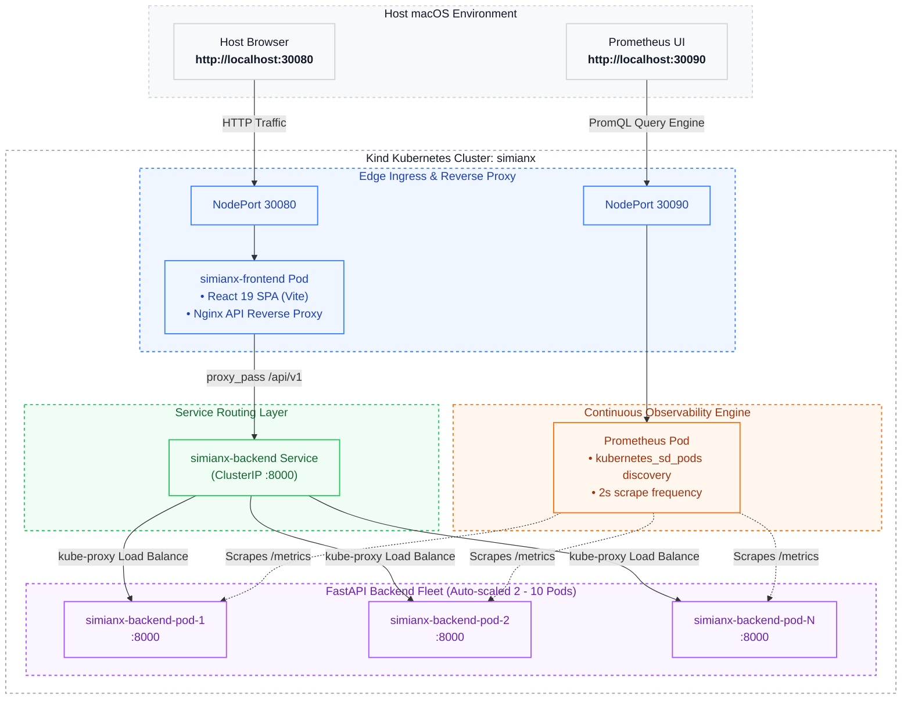

# SimianX — Containerized Kubernetes Observability Guide

> 📖 **Looking for the complete beginner-to-pro interview guide?**
> Check out the **[SRE Interview Masterclass](SRE_INTERVIEW_MASTERCLASS.md)** (550+ lines explaining Docker, Kubernetes, Prometheus, FastAPI, Math behind histograms, and the top 15 interview questions with screenshots).

---

## Architecture Overview



---

## 1. Local Development Workflows

### Option A: Standalone Local Development (No Docker/K8s required)
Preserves the rapid code-reload workflow:
```bash
# Terminal 1: Backend
cd backend
python3 -m venv .venv
source .venv/bin/activate
pip install -e ".[dev]"
uvicorn app.main:app --reload --host 0.0.0.0 --port 8000

# Terminal 2: Frontend
cd frontend
npm install
npm run dev # Runs on http://localhost:5173
```

### Option B: Docker Compose Local Development
Runs backend and frontend in containerized bridge network:
```bash
docker compose up --build
# Access UI on http://localhost:3000
# Backend API directly on http://localhost:8000
```

---

## 2. Deploying to Kubernetes (`kind`)

### Step 1: Create the `kind` Cluster with Ingress Port Mappings
```bash
kind create cluster --config kind-config.yaml --name simianx
```
*Port mappings created:*
- `30080 -> 30080`: SimianX Frontend SPA + API Reverse Proxy
- `30090 -> 30090`: Prometheus Server Dashboard & Metrics API

### Step 2: Build and Load Docker Images
```bash
# Build local images
docker build -t simianx-backend:latest backend/
docker build -t simianx-frontend:latest frontend/

# Load into kind cluster node
kind load docker-image simianx-backend:latest --name simianx
kind load docker-image simianx-frontend:latest --name simianx
kind load docker-image prom/prometheus:v2.54.1 --name simianx
```

### Step 3: Deploy via Helm (or `make kind-up`)
```bash
# Deploy all microservices, RBAC, and Prometheus via Helm
helm upgrade --install simianx ./helm/simianx -n simianx --create-namespace
```

### Step 4: Verify Deployment Status
```bash
kubectl get pods -n simianx -o wide
kubectl get deployments -n simianx
```

---

## 3. Prometheus Metric Instrumentation & Discovery

### Pod Annotations for Auto-Discovery
Each `simianx-backend` pod template contains:
```yaml
annotations:
  prometheus.io/scrape: "true"
  prometheus.io/port: "8000"
  prometheus.io/path: "/metrics"
```

### Verified Prometheus Target Health
Check active targets scraped by Prometheus:
```bash
curl -s http://localhost:30090/api/v1/targets | python3 -m json.tool
```

### Real Aggregate Percentile Calculation (Constraint 8)
Prometheus aggregates histogram bucket counters across **all** active pods before computing the quantile. We **do not** average pod percentiles:

```promql
# Service-Wide Throughput (RPS)
sum(rate(simianx_http_requests_total[15s]))

# Service-Wide Aggregated P95 Latency (ms)
histogram_quantile(0.95, sum(rate(simianx_http_request_duration_seconds_bucket[15s])) by (le)) * 1000

# Service-Wide Aggregated P50 Latency (ms)
histogram_quantile(0.50, sum(rate(simianx_http_request_duration_seconds_bucket[15s])) by (le)) * 1000

# Service-Wide Aggregated P99 Latency (ms)
histogram_quantile(0.99, sum(rate(simianx_http_request_duration_seconds_bucket[15s])) by (le)) * 1000

# Service-Wide Error Rate (%)
clamp_min(sum(rate(simianx_http_requests_total{status_code=~"5.."}[15s])) / sum(rate(simianx_http_requests_total[15s])), 0) * 100
```

---

## 4. Manual Horizontal Scaling (2 to 10 Replicas)

### CLI Scaling:
```bash
# Scale to 10 replicas
kubectl scale deployment simianx-backend --replicas=10 -n simianx
kubectl rollout status deployment/simianx-backend -n simianx

# Scale back to 2 replicas
kubectl scale deployment simianx-backend --replicas=2 -n simianx
kubectl rollout status deployment/simianx-backend -n simianx
```

### UI Scaling:
The SimianX dashboard at `http://localhost:30080` contains preset buttons (`2 Pods`, `4 Pods`, `6 Pods`, `8 Pods`, `10 Pods`) that call `POST /api/v1/infrastructure/scale?replicas=N` to dynamically scale the deployment and stream updated pod states.

### Inspecting Infrastructure State via API:
```bash
curl -s http://localhost:30080/api/v1/infrastructure | python3 -m json.tool
```
Returns:
- `cluster_mode: true`
- `desired_replicas`, `ready_replicas`, `available_replicas`
- List of real active pods (`name`, `ip`, `node`, `ready`, `restarts`)
- Prometheus status (`active_targets_count`, `healthy_targets_count`, per-pod scrape latency)

---

## 5. Running Automated Tests

```bash
cd backend
source .venv/bin/activate
ruff check app/ tests/
pytest tests/ -v
```
All 22 unit and integration tests validate:
- Real non-mocked metric computation and histogram quantile math
- Concurrent experiment prevention
- `/metrics` OpenMetrics format output
- `/api/v1/infrastructure` Kubernetes and Prometheus state extraction

---

## 6. Environment Teardown & Cleanup

### Option A: Remove SimianX Workloads (Keep Cluster)
```bash
kubectl delete namespace simianx
kubectl delete clusterrole simianx-prometheus
kubectl delete clusterrolebinding simianx-prometheus
```

### Option B: Delete Entire `kind` Cluster
```bash
kind delete cluster --name simianx
```
