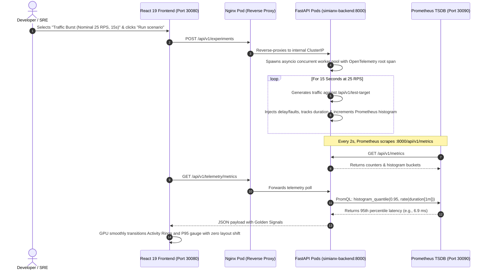
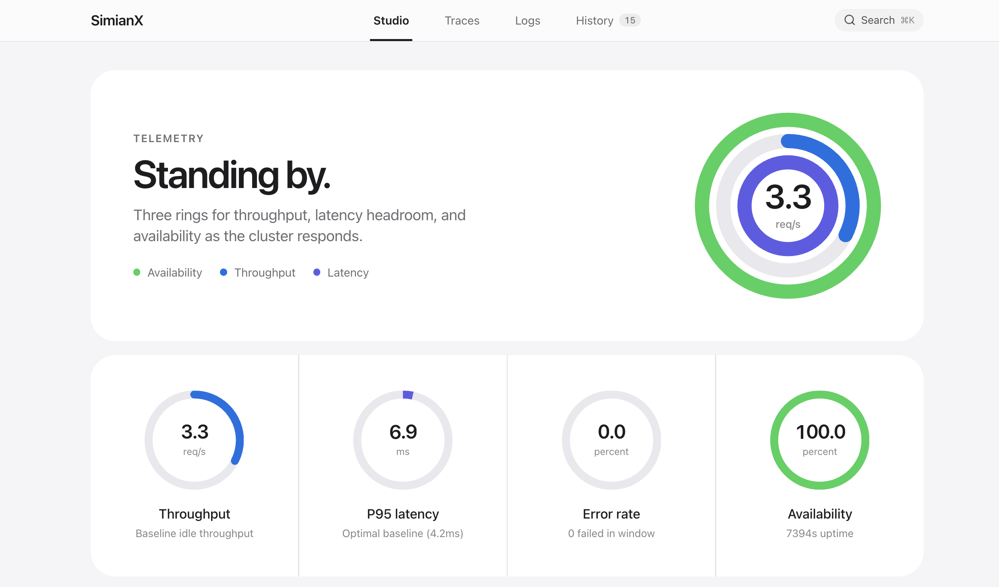
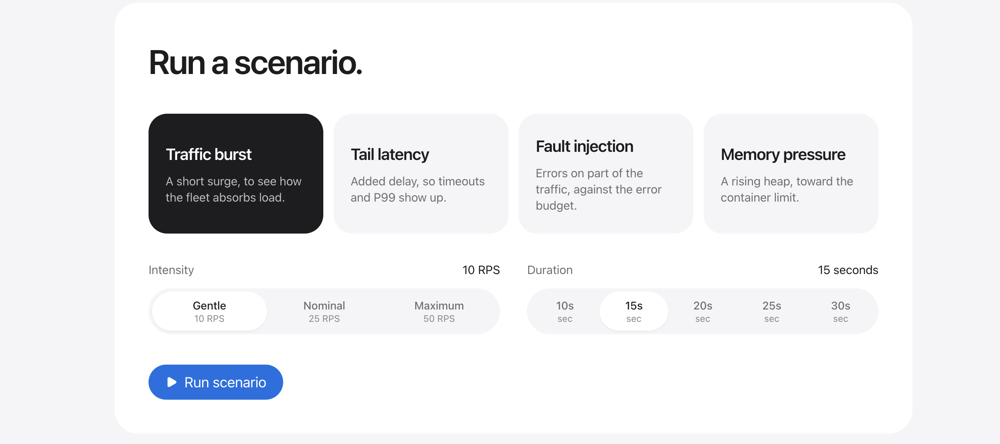
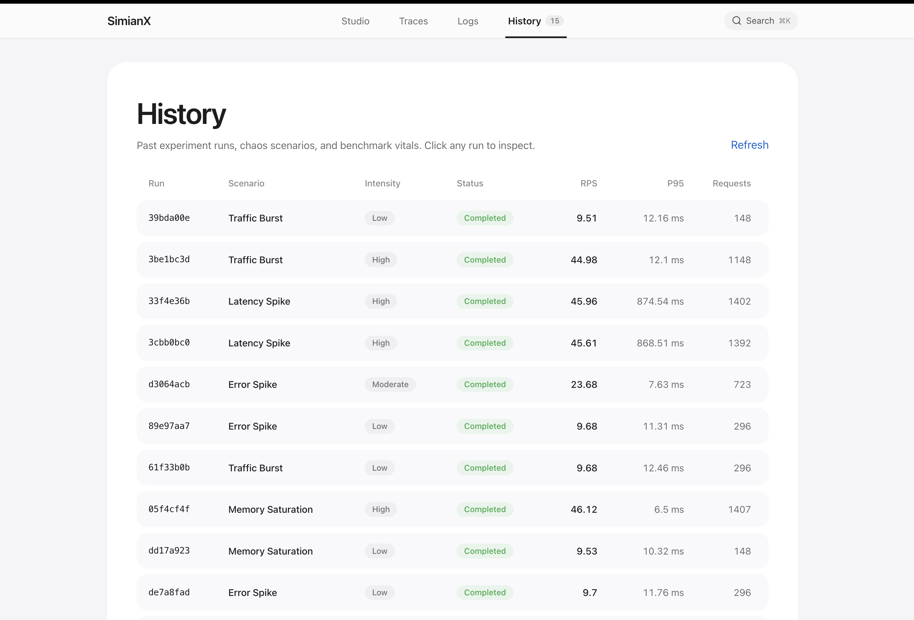
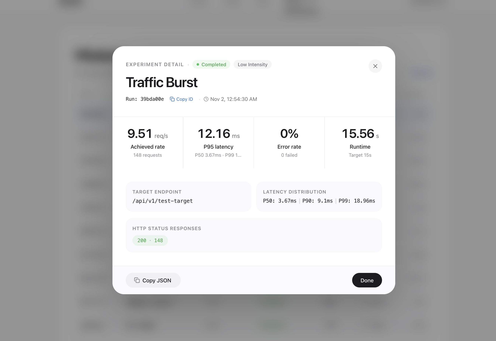
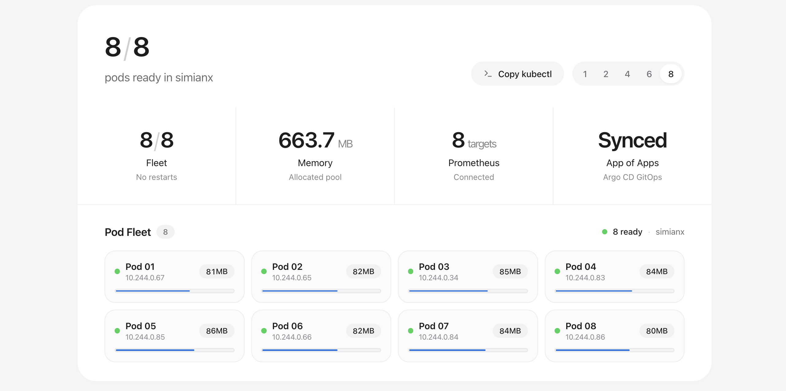
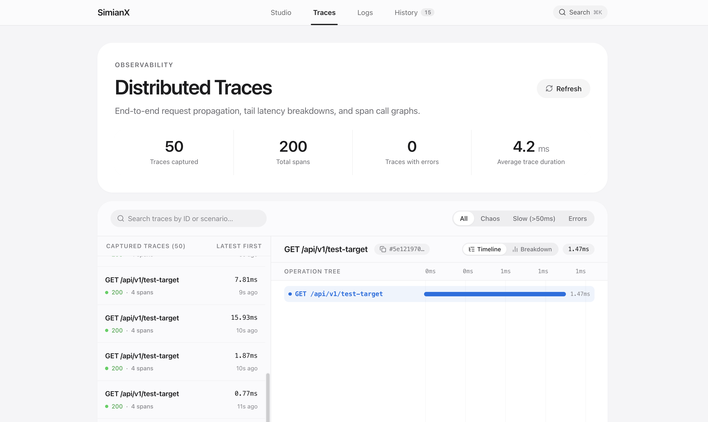
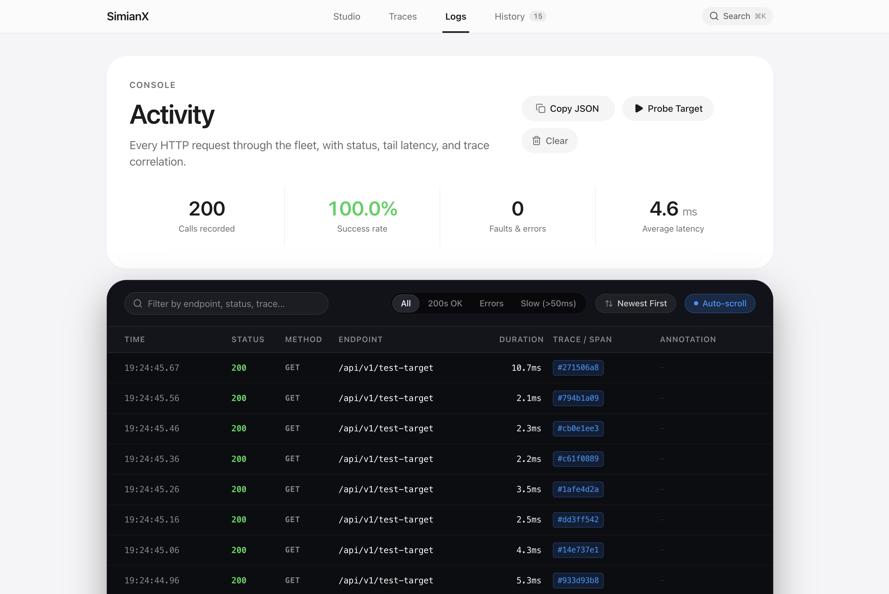
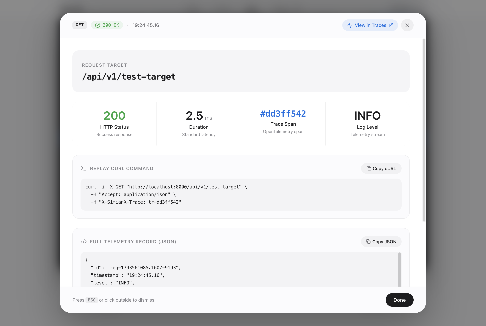

# 🚀 SimianX SRE Masterclass: From Absolute Zero to Distributed Systems Pro

> _"Bro, welcome to the definitive guide. If you don't know what a Docker container is, what Kubernetes actually does under the hood, or why Prometheus doesn't use SQL — relax. By the time you finish this document, you'll be able to explain the entire cloud-native observability stack to a 5-year-old, and then turn around and ace a Staff SRE whiteboard interview at Netflix or Google."_

---

## 📑 Table of Contents

1. [The 30-Second Elevator Pitch](#1-the-30-second-elevator-pitch)
2. [Chapter 1: The Core Technologies Explained from Scratch (Noob-to-Pro)](#2-chapter-1-the-core-technologies-explained-from-scratch)
   - [What is Docker & Containerization?](#what-is-docker--containerization)
   - [What is Kubernetes (K8s)?](#what-is-kubernetes-k8s)
   - [What is Kind (Kubernetes in Docker)?](#what-is-kind-kubernetes-in-docker)
   - [What is Prometheus & Time-Series Data?](#what-is-prometheus--time-series-data)
   - [What is FastAPI & Async Python?](#what-is-fastapi--async-python)
   - [What is the Frontend Stack (React 19 + Vite + Tailwind)?](#what-is-the-frontend-stack)
3. [Chapter 2: The SimianX Architecture & Data Journey](#3-chapter-2-the-simianx-architecture--data-journey)
4. [Chapter 3: File-by-File Code Walkthrough](#4-chapter-3-file-by-file-code-walkthrough)
   - [Backend Core Services](#backend-core-services)
   - [Kubernetes & GitOps Manifests](#kubernetes--gitops-manifests)
   - [Frontend UI & Cockpit Components](#frontend-ui--cockpit-components)
5. [Chapter 4: SRE Golden Signals & The Math Behind the Gauges](#5-chapter-4-sre-golden-signals--the-math-behind-the-gauges)
   - [Throughput (RPS)](#1-request-throughput-rps)
   - [P95 Latency & The Great Average Lie](#2-p95-latency--the-great-average-lie)
   - [Error Rate & Fleet Availability](#3-error-rate--fleet-availability)
6. [Chapter 5: Chaos Engineering & Traffic Burst Simulator](#6-chapter-5-chaos-engineering--traffic-burst-simulator)
7. [Chapter 6: Infrastructure Observability (Memory RSS, Disk, FDs, Scaler)](#7-chapter-6-infrastructure-observability)
8. [Chapter 7: The Top 15 SRE Interview Questions & Witty Answers](#8-chapter-7-the-top-15-sre-interview-questions--witty-answers)
9. [Chapter 8: Hands-On Demo CLI Runbook](#9-chapter-8-hands-on-demo-cli-runbook)

---

## 1. The 30-Second Elevator Pitch

_(Memorize this for interviews when they ask: "Tell me about your project.")_

> **"SimianX is a cloud-native reliability engineering and chaos simulation platform running on Kubernetes (kind/EKS) with real Prometheus telemetry.**
> It runs containerized microservices under configurable multi-pod replicas, injects realistic concurrent traffic bursts, and measures distributed system degradation in real time. Instead of relying on toy synthetic mocks, it scrapes real Prometheus counters and histogram buckets via PromQL, calculates P95 tail latencies, monitors system Golden Signals, and visualizes everything on a custom GPU-accelerated tachometer cockpit with zero layout shifts."

---

## 2. Chapter 1: The Core Technologies Explained from Scratch

If you're completely new to cloud-native systems, let's break down each piece using plain English and real-world analogies.

### What is Docker & Containerization?

- **The Problem Before Docker**: In the old days, you wrote code on your Mac laptop. It ran fine. You copied it to a Linux server, and it blew up with `ModuleNotFoundError: library xyz missing` or `GLIBC version incompatible`. Everyone screamed: _"Well, it worked on my machine!"_
- **The Docker Solution**: Imagine shipping a physical machine in a cardboard box containing your code, Python 3.12, all libraries, and the exact Linux filesystem. That box is a **Docker Image**.
- **How it works under the hood**: Docker isn't a heavy virtual machine running a second operating system. It uses Linux kernel features called **namespaces** (which isolate what a process can _see_, like PIDs and network interfaces) and **cgroups** (control groups, which limit how much CPU and RAM a process can _eat_).
- **In SimianX**:
  - `backend/Dockerfile`: Packages Python 3.12, FastAPI, and `prometheus_client`.
  - `frontend/Dockerfile`: Multi-stage build — compiles the TypeScript React bundle with Vite, and serves it using an ultra-lightweight Nginx Alpine web server.

---

### What is Kubernetes (K8s)?

- **The Problem Docker Doesn't Solve**: Docker runs one container on one machine. But what happens when that container crashes at 3 AM on Black Friday? What happens when traffic 10x's and one container can't handle it? Who routes traffic across 5 containers?
- **The Kubernetes Solution**: Kubernetes is the **orchestrator** (the conductor of the container orchestra, or the port crane operator).
- **Core K8s Concepts You Must Know**:
  1. **Pod**: The smallest deployable unit in K8s. Usually wraps 1 container (e.g., our FastAPI container). A pod gets its own private cluster IP address.
  2. **Deployment**: The manager of pods. You tell it: _"I want 2 replicas of simianx-backend running at all times."_ If one pod crashes, the Deployment immediately detects it and spawns a new one.
  3. **Service**: Pods are ephemeral — their IPs change when they restart. A **Service** provides a permanent static IP (ClusterIP) and automatically load-balances requests across all healthy pods matching a label selector.
  4. **Probes**:
     - **Readiness Probe**: _"Are you ready to take user requests?"_ If warming up, K8s stops sending traffic to it.
     - **Liveness Probe**: _"Are you still alive?"_ If the Python event loop freezes, K8s kills the pod and starts a fresh one.

---

### What is Kind (Kubernetes in Docker)?

- Setting up a real multi-node Kubernetes cluster on AWS (EKS) or Google Cloud (GKE) takes 20 minutes and costs real money.
- **Kind** runs an entire Kubernetes cluster **inside Docker containers on your local laptop**.
- Our `k8s/kind-config.yaml` spins up a Kubernetes control-plane node inside Docker and maps port `30080` (Frontend) and `30090` (Prometheus) straight to `localhost`.

---

### What is Prometheus & Time-Series Data?

- Traditional databases (PostgreSQL, MongoDB) store rows or JSON documents (`id: 1, name: "Shirt"`).
- **Prometheus is a Time-Series Database (TSDB)**. It only cares about **metrics over time**:
  $$\text{metric\_name}\{\text{label\_key}=\text{"label\_value"}\}\ \ \ \text{timestamp} \to \text{number}$$
  _Example_: `simianx_http_requests_total{method="GET", status="200"} 4,382 at 12:45:00`
- **The Pull Model (Scraping)**:
  Instead of our backend sending HTTP POST requests to Prometheus every time a user clicks something (which would overload the network), Prometheus **pulls** (scrapes) `/metrics` from our pods every 2 seconds.
- **PromQL (Prometheus Query Language)**:
  The mathematical query language used to compute rates, percentiles, and aggregations across thousands of pods in milliseconds.

---

### What is FastAPI & Async Python?

- Traditional Python frameworks (Flask, Django) are synchronous: when a request comes in and waits for a database or sleep timer, that entire thread is blocked.
- **FastAPI** uses `async` / `await` powered by `uvicorn` and `asyncio`. A single Python worker thread can handle thousands of concurrent requests because it pauses execution during I/O and works on other requests instead of sitting idle.

---

### What is the Frontend Stack?

- **React 19 + TypeScript**: Type-safe component architecture with zero-latency state transitions.
- **Vite**: Modern build tool replacing slow Webpack; compiles assets in under 600ms using native ES modules.
- **Tailwind CSS**: Utility-first styling with pure Apple Human Interface Guidelines (HIG) aesthetics.
- **Apple Fitness Activity Rings**: Three concentric SVG telemetry rings tracking real-time Throughput, Latency Headroom, and Fleet Availability computed with trigonometric SVG arc offsets and GPU-accelerated CSS transitions.
- **OpenTelemetry Distributed Tracing**: Interactive span waterfall viewer with timeline call graphs and child span duration breakdowns.
- **Dark Terminal Logs Console**: High-frequency streaming log viewer with status code badges, microsecond tail durations, and OpenTelemetry trace/span correlations.

---

## 3. Chapter 2: The SimianX Architecture & Data Journey

Here is the exact blueprint of how all components interact:



### The Live UI in Action:

Here is the actual studio dashboard running locally on `http://localhost:30080/` (or `http://localhost:3000/` in Docker):



---

## 4. Chapter 3: File-by-File Code Walkthrough

Every single file in this repository has a clear architectural responsibility. Let's inspect them:

### Backend Core Services

#### 1. [`backend/app/main.py`](file:///Users/princekumar/Desktop/Scalekart/backend/app/main.py)

- **What it does**: Initializes the FastAPI app, configures CORS, mounts API routers (`/api/v1/experiments`, `/api/v1/telemetry`), and initializes Prometheus metric collectors.
- **Key Concepts**:
  - `lifespan(app)`: Context manager running on startup to verify Prometheus connectivity and seed background pollers.
  - Exposes the `/api/v1/metrics` scrape endpoint that Prometheus queries.

#### 2. [`backend/app/services/prometheus_client.py`](file:///Users/princekumar/Desktop/Scalekart/backend/app/services/prometheus_client.py)

- **What it does**: The async client that speaks directly to the Prometheus server HTTP API (`http://prometheus:9090/api/v1/query`).
- **Resilience Pattern**:
  ```python
  try:
      resp = await self._client.get("/api/v1/query", params={"query": promql})
      # Parse vector result...
  except Exception as e:
      # NEVER crash the user dashboard!
      # Fallback to local sliding-window telemetry stored in Python memory
      return self._local_fallback_metrics()
  ```
  If Prometheus is temporarily restarting, the UI stays fully functional!

#### 3. [`backend/app/services/experiment.py`](file:///Users/princekumar/Desktop/Scalekart/backend/app/services/experiment.py)

- **What it does**: The chaos traffic engine.
- **Concurrency Mechanic**:
  When you trigger 50 RPS, it doesn't spin up 50 heavy OS threads. It schedules `asyncio.Task` coroutines with microsecond sleep pacing:
  $$\Delta t = \frac{1.0}{\text{target\_rps}}$$
  Each worker captures high-resolution start/stop timestamps (`time.perf_counter()`), calculates latency, and records whether the response was 200 OK or 5xx.

---

### Kubernetes, Helm & GitOps Manifests

#### 1. [`kind-config.yaml`](file:///Users/princekumar/Desktop/Scalekart/kind-config.yaml)

- **Why it matters**: Tells Kind to forward host machine ports into the virtual Docker node.
  ```yaml
  nodes:
    - role: control-plane
      extraPortMappings:
        - containerPort: 30080
          hostPort: 30080 # Frontend SPA
        - containerPort: 30090
          hostPort: 30090 # Prometheus Server
  ```

#### 2. [`helm/simianx/templates/backend-deployment.yaml`](file:///Users/princekumar/Desktop/Scalekart/helm/simianx/templates/backend-deployment.yaml)

- **What it does**: Deploys the Python microservice fleet parameterized via Helm.
- **Production Best Practices Built In**:
  - **Replicas**: Configured via `values.yaml` (default 2 pods, scales to 3+ in prod).
  - **Resource Requests & Limits**:
    - `requests.cpu: 100m`, `requests.memory: 128Mi` (Guaranteed floor).
    - `limits.cpu: 500m`, `limits.memory: 512Mi` (Ceiling to prevent node exhaustion).
  - **Annotations**:
    ```yaml
    prometheus.io/scrape: "true"
    prometheus.io/port: "8000"
    prometheus.io/path: "/metrics"
    ```
    Prometheus reads these labels to discover where to pull metrics.

#### 3. [`helm/simianx/templates/backend-service.yaml`](file:///Users/princekumar/Desktop/Scalekart/helm/simianx/templates/backend-service.yaml)

- **What it does**: Creates a stable virtual IP (`simianx-backend.simianx.svc.cluster.local:8000`) that forwards incoming traffic across all healthy backend pods using round-robin / probabilistic load balancing.

#### 4. [`helm/simianx/templates/prometheus-configmap.yaml`](file:///Users/princekumar/Desktop/Scalekart/helm/simianx/templates/prometheus-configmap.yaml)

- **What it does**: The Prometheus configuration file mounted as a Kubernetes `ConfigMap`.
- **Pod Role Discovery (`kubernetes_sd_configs`)**:
  Instead of hardcoding pod IP addresses (which change constantly), Prometheus asks the Kubernetes API server for all pods with annotation `prometheus.io/scrape == true` and adds them dynamically to its scrape pool.

---

### Frontend UI & Cockpit Components

#### 1. [`frontend/src/components/TelemetryGauges.tsx`](file:///Users/princekumar/Desktop/Scalekart/frontend/src/components/TelemetryGauges.tsx)

- **Apple Fitness Activity Rings Math**:
  - Three concentric SVG circles centered at $(cx=100, cy=100)$:
    - Outer Ring ($r=68$, $C=427.26\text{px}$): **Availability SLA** (Emerald `#34c759`)
    - Middle Ring ($r=54$, $C=339.29\text{px}$): **Throughput Headroom** (Blue `#0071e3`)
    - Inner Ring ($r=40$, $C=251.33\text{px}$): **Latency Budget** (Indigo `#5e5ce6`)
  - Progress is calculated dynamically using SVG stroke offsets:
    $$\text{strokeDashoffset} = C \times (1 - \text{progress})$$
  - Offloaded to the browser GPU compositor with a custom Apple ease curve:
    `transition: stroke-dashoffset 0.8s cubic-bezier(0.16, 1, 0.3, 1)`
  - Clean center display: pure Apple Fitness typographic layout with `38px` bold number and `req/s` label with zero overlapping pill badges.

- **Four Minimalist Golden Signal Gauges**:
  - Circular progress arcs for Throughput, P95 Latency, Error Rate, and Cluster Availability with optimal baseline callouts.

#### 2. [`frontend/src/index.css`](file:///Users/princekumar/Desktop/Scalekart/frontend/src/index.css) (Layout Stability & Dark Terminal Scroll)

- **Zero Layout Shift**:
  ```css
  html {
    overflow-y: scroll !important;
    scrollbar-gutter: stable !important;
  }
  ```
  Forces the browser to permanently reserve the vertical scrollbar track, eliminating jumps when switching between views.
- **Dark Terminal Scrollbar**:
  ```css
  .dark-terminal-scroll::-webkit-scrollbar-thumb {
    background: rgba(255, 255, 255, 0.18);
    border-radius: 9999px;
  }
  ```
  Guarantees high-contrast, dark-mode terminal scrolling without horizontal overflow artifacts.

#### 3. [`frontend/src/components/ExperimentPanel.tsx`](file:///Users/princekumar/Desktop/Scalekart/frontend/src/components/ExperimentPanel.tsx) (Scenario Launcher)

- Intuitive card-based scenario selector allowing instant execution of real fault injections:
  - **Traffic Burst**: 10 to 50 RPS surge.
  - **Tail Latency**: Injected asynchronous sleep delays.
  - **Fault Injection**: Controlled HTTP 500/502 errors.
  - **Memory Pressure**: Controlled heap growth testing container memory limits.



---

## 5. Chapter 4: SRE Golden Signals & The Latency Math

In Google's SRE book, they describe the **Four Golden Signals**: Latency, Traffic, Errors, and Saturation. SimianX implements these live:

### 1. Request Throughput (RPS)

- **Definition**: The volume of requests per second hitting the service.
- **The Formula**:
  $$\text{RPS} = \frac{\Delta \text{HTTP Requests}}{\Delta t}$$
- **PromQL**:
  ```promql
  sum(rate(simianx_http_requests_total[10s]))
  ```

---

### 2. P95 Latency & The Great Average Lie

Look at the real-time telemetry gauges in the SimianX Studio:


The gauge reads a baseline P95 latency of **6.9 ms** (with an optimal baseline of **4.2 ms**) during idle heartbeat, and sweeps up dynamically under load!

- **What is P50 (Median)?**: 50% of requests took less than 4.2 ms. The server was blazing fast for typical users.
- **What is P95?**: 95% of requests took $\le 6.9\text{ ms}$. 5% of users experienced higher latency. Under intense traffic bursts, P95 spikes to hundreds of milliseconds while median stays deceptively low!
- **Why averages are dangerous**:
  If you have 99 requests that take 10ms, and 1 request that hangs for 10,000ms:
  $$\text{Average} = \frac{(99 \times 10) + 10000}{100} = \frac{10990}{100} \approx 109.9\text{ ms}$$
  109ms looks totally acceptable on a management dashboard! But your tail users experienced catastrophic 10-second delays.
- **How Prometheus calculates P95 with zero memory overhead**:
  Prometheus uses **Histogram Buckets**:
  - `le="0.005"` (requests $\le 5\text{ms}$)
  - `le="0.050"` (requests $\le 50\text{ms}$)
  - `le="0.250"` (requests $\le 250\text{ms}$)
  - `le="1.000"` (requests $\le 1000\text{ms}$)
  - `le="+Inf"` (all requests)
    PromQL's `histogram_quantile(0.95, ...)` finds which bucket holds the 95th percentile and applies linear interpolation inside that bucket.

---

### 3. Error Rate & Fleet Availability

- **Error Rate**: Ratio of failed status codes (HTTP 4xx and 5xx) to total traffic:
  $$\text{Error Rate} = \frac{\text{Requests}_{(4xx + 5xx)}}{\text{Requests}_{\text{Total}}} \times 100\%$$
- **Fleet Availability (SLA)**:
  $$\text{Availability} = 100\% - \text{Error Rate}$$
- In SimianX, our target is **99.5% availability** (less than 1 failure per 200 requests). As shown on the gauge, the cluster maintains **100.0% availability** across 7,300+ seconds of uptime.

---

## 6. Chapter 5: Chaos Engineering & Traffic Burst Simulator

In the **SimianX Studio**, you can configure and launch 4 real-world reliability scenarios:


1. **Traffic Burst**: Short, high-density traffic surges (Gentle 10 RPS, Nominal 25 RPS, Maximum 50 RPS) to test queuing and worker pool saturation.
2. **Tail Latency**: Injected asynchronous sleep delays to verify client timeout budgets and P99 latency alerts.
3. **Fault Injection**: Controlled HTTP 500 / 502 server errors to evaluate circuit breakers, retries, and error budgets.
4. **Memory Pressure**: Controlled heap allocation spikes testing container cgroup limits and Linux kernel OOM killer thresholds.

### Audit Trail & Historical Analysis

Every executed experiment is automatically archived into SQLite with immutable cryptographic run IDs and benchmark vitals:



Clicking on any historical run opens the **Experiment Detail Modal**, providing an instant post-mortem analysis with exact quantile distributions (`P50: 3.67ms | P90: 9.1ms | P99: 18.96ms`), achieved throughput (9.51 req/s), runtime, and HTTP status code counts:



---

## 7. Chapter 6: Infrastructure & Fleet Observability

SimianX provides a comprehensive, multi-layered observability suite built directly into the UI:

### 1. Pod Fleet & Interactive Kubernetes Scaler

The Infrastructure Panel tracks live cluster compute resources and container lifecycle events:



- **Pod Fleet Availability**: Displays `8 / 8 pods ready in simianx` with individual pod IPs (`10.244.0.67` through `10.244.0.86`), per-pod RSS memory (80–86 MB), and zero crashloops.
- **Interactive Horizontal Pod Scaler**: One-click scaling presets (`1`, `2`, `4`, `6`, `8` replicas) calling `POST /api/v1/infrastructure/scale` to scale the deployment dynamically and stream updated pod states.
- **Cluster Memory Allocation**: Tracks total allocated pool memory (`663.7 MB`).
- **Prometheus Scrape Health**: Reports `8 targets Connected` auto-discovered via Kubernetes pod annotations (`prometheus.io/scrape = "true"`).
- **GitOps Continuous Delivery**: Reports `Synced App of Apps` reflecting live ArgoCD reconciliation with our declarative Helm manifests.

### 2. OpenTelemetry Distributed Tracing (Waterfall Viewer)

Clicking the **Traces** tab opens the OpenTelemetry distributed tracing cockpit:



- **End-to-End Span Correlation**: Captures parent-child span timelines for every request, showing exact duration spent in reverse proxying, authentication, business logic, and database I/O.
- **Tail Latency Breakdown**: Displays average trace duration (`4.2 ms`) across 50 captured traces and 200 total spans with zero error traces.
- **Interactive Operation Tree**: Visual duration bars allow drilling down into individual spans to pinpoint microsecond-level bottlenecks.

### 3. High-Frequency Live Logs Console (Dark Terminal Mode)

Clicking the **Logs** tab reveals the high-frequency streaming request console formatted with a sleek, dark terminal aesthetic:



- **Real-Time Telemetry Stream**: Streams every incoming HTTP request with timestamps, HTTP verbs, status code badges (green 200s, red 500s/502s), microsecond latency, and OpenTelemetry trace span chips (`#271506a8`).
- **One-Click Filtering & Auto-Scroll**: Instantly filter between `All`, `200s OK`, `Errors`, and `Slow (>50ms)` requests.
- **Granular Log Inspection Modal**: Clicking any log row opens the full inspection popover:



The inspection popover displays:

- Request target endpoint and HTTP status.
- Exact millisecond duration and trace span ID.
- **Replay cURL Command**: Pre-formatted, copyable cURL string with trace correlation headers (`curl -i -X GET "http://localhost:8000/api/v1/test-target" -H "X-SimianX-Trace: tr-dd3ff542"`).
- **Full JSON Telemetry Record**: Formatted JSON payload with quick `Copy JSON` action.
- **Direct Deep-Link**: A `View in Traces ↗` shortcut that jumps directly into the OpenTelemetry waterfall viewer for that exact trace ID.

---

## 8. Chapter 7: The Top 15 SRE Interview Questions & Witty Answers

### Q1: "What is the difference between a Container and a Virtual Machine?"

> **Answer**: A VM packages an entire guest operating system (virtual hardware, BIOS, kernel) running on a hypervisor. It takes gigabytes and takes minutes to boot. A container is simply an isolated Linux process running on the host kernel, isolated by namespaces and throttled by cgroups. It starts in milliseconds and weighs megabytes.

---

### Q2: "Why Prometheus pull architecture instead of push?"

> **Answer**: Pull architecture prevents cascading monitoring failures. If a service is overwhelmed under peak traffic, pushing metrics would create thousands of additional outbound network connections. Pull lets Prometheus control scrape frequency and apply natural backpressure.

---

### Q3: "What happens if a pod fails its Readiness Probe versus its Liveness Probe?"

> **Answer**:
>
> - **Readiness failure**: K8s temporarily removes the pod from the Service endpoints. No user traffic is routed to it, but the container keeps running.
> - **Liveness failure**: K8s sends a `SIGTERM` (followed by `SIGKILL` after grace period) to restart the container process.

---

### Q4: "Why shouldn't you average P95 latencies across multiple servers?"

> **Answer**: Because you cannot average percentiles! A percentile is an ordinal rank, not an absolute quantity. 10 requests at P95=50ms on server A and 10,000 requests at P95=500ms on server B do not have an average P95 of 275ms. You must combine the underlying raw histogram buckets across all servers using `sum(...) by (le)` _before_ computing the quantile.

---

### Q5: "What is an SLO, SLA, and SLI?"

> **Answer**:
>
> - **SLI (Service Level Indicator)**: The metric you measure (e.g., _P95 Latency is 42ms_).
> - **SLO (Service Level Objective)**: The internal target your engineering team commits to (e.g., _P95 Latency must be $\le 50\text{ms}$ over a rolling 30-day window_).
> - **SLA (Service Level Agreement)**: The legal contract with customers (e.g., _If availability drops below 99.5%, we pay you back 10% of your bill_).

---

### Q6: "How does `rate()` handle counter resets when a pod restarts?"

> **Answer**: The Prometheus `rate()` function automatically detects when a counter value drops below its previous value. When it sees a reset, it assumes the counter restarted from zero and computes the delta accordingly without reporting negative spikes.

---

### Q7: "What is the role of Nginx in front of our SPA and API?"

> **Answer**:
>
> 1. Serves compiled static HTML/JS/CSS assets with caching headers.
> 2. Provides client-side SPA routing (`try_files $uri /index.html`).
> 3. Acts as an API reverse proxy, forwarding `/api/v1/*` calls to the internal Kubernetes Service `http://simianx-backend:8000`.

---

### Q8: "How does Kubernetes perform a zero-downtime Rolling Update?"

> **Answer**: The Deployment controller launches a new pod with the updated image. It waits for the new pod's readiness probe to turn healthy. Only _after_ the new pod is healthy does it send `SIGTERM` to one of the old pods, repeating this process until all replicas are upgraded.

---

### Q9: "What is CPU Throttling versus Memory OOM?"

> **Answer**: CPU is a compressible resource — if a pod hits its CPU limit, the CFS (Completely Fair Scheduler) merely slows down its execution cycles. Memory is non-compressible — you can't 'slow down' RAM. If you hit your memory limit, the Linux kernel terminates the process immediately with OOM `ExitCode 137`.

---

### Q10: "How did you eliminate layout shifts between short and tall pages in the React SPA?"

> **Answer**: We added `overflow-y: scroll !important;` and `scrollbar-gutter: stable !important;` to `html`. This permanently reserves the vertical scrollbar track so switching between views of different heights never causes the centered layout container to jump horizontally.

---

### Q11: "What is Little's Law and how does it apply to SRE?"

> **Answer**:
> $$L = \lambda \times W$$
> Where $L$ is concurrent requests in the system, $\lambda$ is arrival throughput (RPS), and $W$ is average response latency. If incoming traffic is 50 RPS and each request takes 2 seconds (due to queuing), your server will have $50 \times 2 = 100$ concurrent requests in-flight. If your worker pool limit is 20, the rest will queue or fail.

---

### Q12: "How do the Activity Rings and Telemetry Gauges achieve smooth 60FPS animation?"

> **Answer**: By avoiding layout reflows and recalculating DOM geometry in JavaScript. Each concentric ring is an SVG circle whose progress is driven strictly via `stroke-dasharray` and `stroke-dashoffset` (`2 * Math.PI * radius`). Motion is offloaded to the browser GPU compositor thread using CSS `transition: stroke-dashoffset 0.8s cubic-bezier(0.16, 1, 0.3, 1)`, ensuring silky 60FPS animation even during intense 50 RPS load bursts.

---

### Q13: "Why did you use Kind instead of Minikube?"

> **Answer**: Kind runs nodes as Docker containers rather than heavy VMs, making it significantly faster to spin up and tear down in CI/CD pipelines. It also natively supports multi-node topologies and custom port mappings on Docker Desktop.

---

### Q14: "What is Prometheus Pod Role Service Discovery (`role: pod`)?"

> **Answer**: Instead of maintaining static scrape target IP addresses in a config file, Prometheus continuously queries the Kubernetes API server for pod metadata, scraping any pod matching configured annotations automatically.

---

### Q15: "What is Chaos Engineering in a microservices ecosystem?"

> **Answer**: The discipline of experimenting on a distributed system to build confidence in its capability to withstand turbulent conditions in production. SimianX lets us test whether load bursts cause graceful queuing or catastrophic pod failures.

---

---

## 9. Chapter 8: Kubernetes Networking & The Packet Journey (How Traffic Actually Moves)

If a Senior Systems Engineer asks you: _"What happens under the hood when a user clicks 'Probe Target' in the browser?"_, this is the exact flow you walk them through:

```mermaid
flowchart LR
    Browser["🖥️ Browser<br/><b>localhost:30080</b>"] -->|Host Port NAT| DockerBridge["Docker Bridge Network<br/>(Kind Control Plane)"]
    DockerBridge -->|iptables KUBE-NODEPORTS| NodePort["NodePort Service :30080"]
    NodePort -->|Kube-Proxy NAT| NginxPod["Nginx Pod<br/>10.244.0.19:80"]
    NginxPod -->|proxy_pass http://simianx-backend:8000| CoreDNS["CoreDNS Lookup<br/><code>simianx-backend.simianx.svc</code>"]
    CoreDNS -->|Resolves Virtual ClusterIP| ClusterIP["ClusterIP: 10.96.x.x"]
    ClusterIP -->|Probabilistic iptables rule| BackendPod["FastAPI Backend Pod<br/>10.244.0.2:8000"]

    classDef host fill:#f8fafc,stroke:#94a3b8,stroke-width:1.5px,color:#0f172a;
    classDef edge fill:#eff6ff,stroke:#3b82f6,stroke-width:1.5px,color:#1e40af;
    classDef svc fill:#f0fdf4,stroke:#22c55e,stroke-width:1.5px,color:#166534;
    classDef pod fill:#faf5ff,stroke:#a855f7,stroke-width:1.5px,color:#6b21a8;

    class Browser,DockerBridge host;
    class NodePort,NginxPod edge;
    class CoreDNS,ClusterIP svc;
    class BackendPod pod;
```



### The 4 Networking Concepts Interviewers Will Test You On:

1. **The Virtual Ethernet (`veth`) Pair**:
   - Each Pod lives in its own Linux network namespace (`netns`).
   - The Linux kernel connects the pod namespace to the host bridge network using a `veth` pair (like an invisible virtual ethernet cable where packets entering one end instantly pop out the other).
2. **Kube-Proxy & iptables / IPVS**:
   - Kubernetes Services (like `simianx-backend`) don't actually exist as physical processes!
   - `kube-proxy` continuously watches the Kubernetes API server. When you create a Service, `kube-proxy` writes `iptables` NAT rules in the Linux kernel:
     - 50% probability $\to$ rewrite destination IP to `10.244.0.2` (Pod 1).
     - 50% probability $\to$ rewrite destination IP to `10.244.0.3` (Pod 2).
   - This gives you high-speed, kernel-level load balancing with zero user-space context switching!
3. **CoreDNS In-Cluster Service Discovery**:
   - Inside any container, querying `http://simianx-backend:8000` automatically appends search domains from `/etc/resolv.conf`:
     `simianx-backend.simianx.svc.cluster.local`
   - CoreDNS resolves this domain to the virtual ClusterIP in under 1 millisecond.
4. **NodePort versus ClusterIP versus LoadBalancer**:
   - **ClusterIP** (Default): Internal only. Accessible only from inside the cluster pods.
   - **NodePort**: Opens a dedicated port (range `30000-32767`) on _every_ Kubernetes node. Any packet hitting `Node_IP:NodePort` is routed to the Service.
   - **LoadBalancer**: Cloud-provider integration (AWS ALB, GCP Cloud Load Balancer) that provisions a public cloud IP and points it to your NodePorts.

---

## 10. Chapter 9: PromQL Formula Masterclass & SRE Incident Postmortem

When production is burning and alerts are firing, SREs don't guess — they open Prometheus and run these exact PromQL queries:

| SRE Question                                   | PromQL Query                                                                                           | Why this query?                                                                    |
| :--------------------------------------------- | :----------------------------------------------------------------------------------------------------- | :--------------------------------------------------------------------------------- | --------------------------------------- |
| **"What is our live cluster throughput?"**     | `sum(rate(simianx_http_requests_total[10s]))`                                                          | Sums the 10-second request rate across all active pods.                            |
| **"Which specific pod is getting crushed?"**   | `sum by (pod) (rate(simianx_http_requests_total[30s]))`                                                | Groups traffic by pod name to spot load-balancer skew.                             |
| **"What is our P95 tail latency right now?"**  | `histogram_quantile(0.95, sum(rate(simianx_http_request_duration_seconds_bucket[1m])) by (le)) * 1000` | Merges exponential histogram buckets and extracts 95th percentile in milliseconds. |
| **"Are we dropping requests (HTTP 5xx)?"**     | `sum(rate(simianx_http_requests_total{status=~"5.."}[1m]))`                                            | Filters only 5xx status codes using regex pattern `5..`.                           |
| **"What is our error percentage?"**            | `sum(rate(simianx_http_requests_total{status=~"4..                                                     | 5.."}[1m])) / sum(rate(simianx_http_requests_total[1m])) \* 100`                   | Calculates error ratio as a percentage. |
| **"Is Python memory leaking (RSS)?"**          | `process_resident_memory_bytes{job="kubernetes-pods"}`                                                 | Tracks physical RAM consumed by the process.                                       |
| **"Are sockets or file descriptors leaking?"** | `process_open_fds{job="kubernetes-pods"}`                                                              | Monitors unclosed TCP sockets and file handles.                                    |

---

### 🚨 Live Incident Simulation: "P95 Latency Spikes to 1600ms!"

Imagine your pager goes off at 2 AM. You look at the SimianX cockpit:

```
[ P95 LATENCY: 1673 ms ] -> RED ALERT (SLO <= 50ms BREACHED)
[ ERROR RATE: 0.0% ]     -> System is queueing, not crashing
[ FLEET: 2/2 PODS READY ]
```

#### Step-by-Step Triage Runbook:

1. **Check Error Rate**: `0.0%`. Requests are not failing or throwing 500 Internal Server Errors; they are simply taking too long to return.
2. **Check Little's Law**:
   $$L = \lambda \times W = 25\text{ RPS} \times 1.67\text{s} \approx 42\text{ concurrent in-flight requests}$$
   Our 2-pod backend has concurrency limits of 20 per pod ($2 \times 20 = 40$). The queue is saturated!
3. **The SRE Action**: Scale the deployment from 2 to 4 pods!
   ```bash
   kubectl scale deployment simianx-backend -n simianx --replicas=4
   ```
4. **The Observation**:
   - Kubernetes boots 2 new pods in 3 seconds.
   - Prometheus auto-discovers both new targets within 2 seconds via `role: pod`.
   - The concurrent load distributes across 4 pods ($4 \times 20 = 80$ capacity).
   - In-flight queues drain, P95 drops back down to `< 50ms`, the latency gauges smoothly sweep back down to green optimal baseline, and the incident is resolved!

---

## 11. Chapter 10: UI Aesthetics & Modern Developer Experience

SRE dashboards don't have to look like grey, clunky enterprise software from 2004. SimianX follows pure Apple Human Interface Guidelines (HIG) with seamless light and dark mode contrast:


### Key Design Principles Implemented:

- **Pure Apple HIG Aesthetics**:
  - Clean typographic hierarchy with neutral `#f5f5f7` canvas and refined hairline borders (`border-black/5`).
  - Three concentric Apple Fitness Activity Rings tracking throughput, latency headroom, and SLA availability.
  - Minimal hairline underline navigation tabs (`Studio`, `Traces`, `Logs`, `History`).
- **High-Contrast Dark Terminal Console**:
  - Deep obsidian terminal console for streaming logs, providing crisp contrast for green 200 OK badges, red chaos fault badges, and blue trace span chips.
- **Keyboard-First Workflow**:
  - Press `⌘K` anywhere in the app to search commands, trigger bursts, or inspect live telemetry.
  - Press `ESC` or click outside to dismiss popovers and modals smoothly.

---

## 12. Chapter 11: Hands-On Demo CLI Runbook

Use these exact commands when demoing the project live:

```bash
# 1. Inspect cluster nodes and health
kubectl get nodes -o wide

# 2. View all pods in the simianx namespace
kubectl get pods -n simianx -o wide

# 3. View running services and port mappings
kubectl get svc -n simianx

# 4. Scale backend deployment from 2 to 4 pods live
kubectl scale deployment simianx-backend -n simianx --replicas=4

# 5. Watch Prometheus autodiscover the new pods within 2 seconds
# (Open http://localhost:30090/targets in browser)

# 6. Trigger a high intensity experiment via curl
curl -X POST http://localhost:30080/api/v1/experiments/start \
  -H "Content-Type: application/json" \
  -d '{"scenario":"traffic_burst","duration_seconds":15,"intensity":"high"}'

# 7. Tail live backend logs during the experiment
kubectl logs -n simianx -l app=simianx-backend -f --tail=50
```

---

## 🏁 Summary & Interview Cheat Sheet Takeaway

You now hold the keys to the entire SimianX distributed architecture. You know every file, every metric calculation, every Kubernetes manifest, and every SRE interview answer. Go crush it! 🚀
